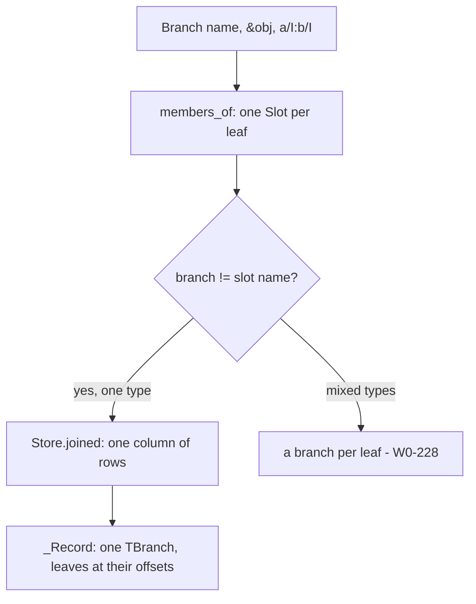

A leaf list of several leaves is **one** `TBranch` whose single basket holds a row per entry, each leaf at its own `fOffset` — and in this kit the machinery for it existed twice over except where the store handed the writer its columns.

The oracle's answer for `t.Branch("pairb", &s, "first/I:second/I")` is `branch [pairb] title=[first/I:second/I] leaves=2 baskets=1`, offsets 0 and 4, `fLen` 1 each. `_Record` in `wtree.py` already says so in its docstring (*"a leaf list, `a/F:b/F:c/F` … which is how ROOT writes `Branch(name, &struct, "a/F:b/F")`"*) and lays the leaves out; the *reader* already takes such a branch from a ROOT file and `SetBranchAddress` fills an object from it.

The gap was the store: one slot per leaf, one column per slot, so the writer made a branch per leaf. A leaf list's slots are the only ones whose `branch` is not their own name, so they group by it — one column of rows (`np.column_stack`) handed to the writer under the branch's name.

## What to check when a branch's name vanishes in a written file

1. `SetBranchAddress(name, obj)` answering `unknown branch` for a branch the same session created means the **writer** renamed it — look at what the store's `specs()` hands over, not at `Branch`.
2. The layout's record lookup (`layout.py::_stored`) must ask `stats.branches[branch name]`, not `[leaf name]`: one branch is one set of baskets, and only a branch's name is a key in what was written.
3. An existing test can be the specification: `tests/test_pyroot_trees_write.py` already asserted ROOT's title and leaf count while reading values by top-level leaf name — the keys were the stale half.
4. A *mixed*-type leaf list needs a per-leaf type in the row (`_Record`'s `parts` takes a per-leaf tuple); until then the in-memory layout groups the leaves into one branch while the file holds two.
