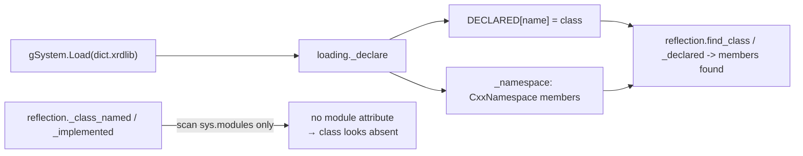

A class from a loaded dictionary reaches the kit through `DECLARED`, not through a module attribute, and code that looks classes up by scanning `sys.modules` therefore cannot see one that a library just declared. That is why three plausible repairs to the `CheckMissingDictionaries` regression all failed: they all changed how modules are scanned. `src/xrdroot/pycint/library/loading.py:248` (`_declare`) is the boundary — it writes each class into `DECLARED` when `getattr(value, "__module__", None) == MODULE or name in loaded.library.names`, and `_namespace` (line 308) adds a namespace's members to an existing `CxxNamespace`.

## The two lookups, and which one a fix must touch

```bash
grep -n 'DECLARED\[' src/xrdroot/pycint/library/loading.py      # where a load declares classes
grep -n 'def _class_named\|def _implemented' src/xrdroot/pyroot/core/reflection.py
```



A dictionary's translated module is a **dict**, not an entry in `sys.modules`, so `getattr(module, name)` over loaded modules finds nothing for it. Only `DECLARED` has the class.

## What to check before "fixing" a lookup

- Does the class arrive through `DECLARED` (a load) or through a module (an import)? `xrdroot.pyroot` classes are the second kind, dictionary classes the first.
- `TClass._fields()` reads `self._declared()`; `TClass._class()` is `_declared(name) or _class_named(name)`, so a stale or module-only fallback changes the answer before `DECLARED` is consulted.
- Any cache over either lookup must be invalidated by `_declare` — by a load — and a load may import no module at all, so `len(sys.modules)` is not a valid cache key.

## Where the open bug stands

`roottest/root/io/withoutDictionaries/CheckMissingDictionaries` fails at `75478091` and later, passes with `reflection.py` reverted to `75478091^`, and does not pass with either half reverted alone. The next step is a pairwise test of the three hunks with the fixture rebuilt each time (~35 s per run), or a harness change that lets several `src` variants share one built fixture.
