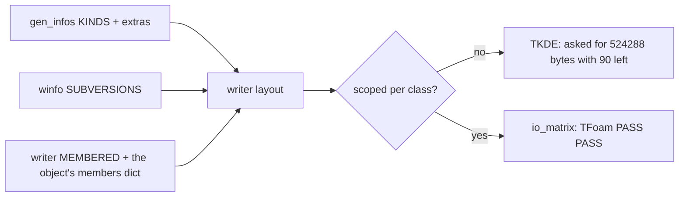

A pointer-bearing class now crosses a ROOT file in both directions, and the whole thing is **three tables plus one scoping rule**. `TFoam` is the worked example: `tools/io_matrix --classes TFoam` reports `PASS PASS`, and the committed code is `1492777b`.

```bash
python -m tools.harvest_infos --root-prefix ~/.local/root-oracle ~/.cache/xrdroot-runs/foam_donor.root > /tmp/foam.json
python /Users/rcurrie/.cache/xrdroot-runs/gen_infos.py /tmp/foam.json TFoam >> src/xrdroot/winfo.py
PYTHONPATH=$PWD/src pytest -q tests/test_writer_tarray.py tests/test_pyroot_tkde.py   # 113 passed
PYTHONPATH=$PWD/src python -m tools.io_matrix --oracle-prefix ~/.local/root-oracle --classes TFoam --out DIR
```



## The three tables

| table | entry |
|---|---|
| `tools/gen_infos.py` `KINDS` + extras | `501`/`64` → `TStreamerObjectPointer`, `48` → `TStreamerBasicPointer`, `300` → `TStreamerArtificial`; artificial extra `(1,)`; basic pointer extra `(2, counter, type)` with the counter read from the title `"[fDim] …"` |
| `src/xrdroot/winfo.py` `SUBVERSIONS` | `"TStreamerArtificial": 1` |
| `src/xrdroot/writer.py` | `_pointed_array` (501, one slot per counter: null tag or the object), `_number_array` (48), and `_written_element`'s flat-member cast must skip both |

## The scoping rule, which is the part that bites

Every one of those writes is keyed **per class**, never by streamer type:

- `COUNTED_ARRAYS = {"TFoam"}` — a counted array taken from the row;
- `ARTIFICIAL_SKIPPED = {"TFoam"}` — an element described but not written;
- `SKIPPED_IN_CAST = {"TFoam"}` — left out of the flat-member cast.

A global rule for `stype 300` broke `TKDE` (`asked for 524288 bytes with 90 left`) and a global `stype 48` broke `TGraph2D`'s `fX` into silent garbage. Each new class is added to these sets **after** its own `io_matrix` pass, which is what keeps a read-back regression from landing unseen.
