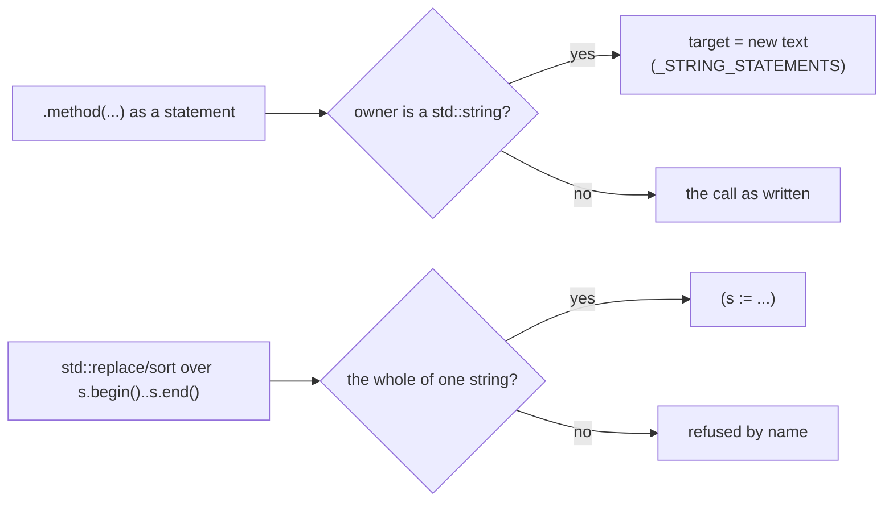

A `std::string` is a Python `str`, which nothing writes in place, so a member that changes the string is translated to an **assignment back to its variable** — and that means every write path has to be a statement. `append`, `push_back`, `clear`, `assign`, `resize`, `pop_back`, `erase(...)`, `insert(...)` and `replace(...)` each have an entry in `_STRING_STATEMENTS` (`src/xrdroot/pycxx/emit_stmt.py`), reached only when the call *is* a statement; the same call in the middle of an expression is still refused as "changing this in the middle of an expression".

## The consequence for an algorithm over a range

`std::replace(s.begin(), s.end(), a, b)` cannot write through the iterators the way it does over a `std::vector`, so `CallEmitter._replace` emits `(s := s.replace(a, b))` instead of `replace_range(...)`. Only the **whole** of a string can be done that way — a partial range (`s.begin() + 1, s.end()`) is refused by name rather than left to fail as `TypeError: 'str' object does not support item assignment`.

## What to do instead of guessing

Add the member to `_STRING_STATEMENTS` with a test in `tests/test_cint_calls.py` that runs the snippet and prints the text; an arity the kit does not write should `raise refuse(...)` so the failure names itself.
