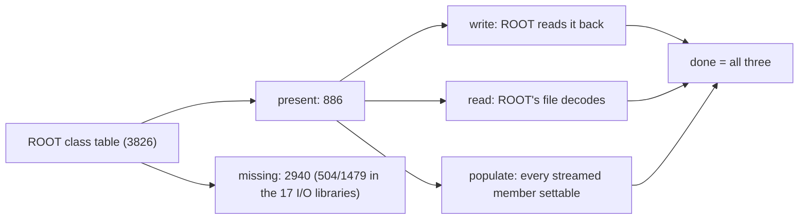

"All of ROOT's data objects" has a measurable denominator: ROOT 6.40.04's own API dump knows 3826 classes in the libraries xrdroot covers, of which xrdroot has **886 present and 2940 missing**; across the seventeen I/O-relevant libraries it is 504 present and 1479 missing. A class merely existing is not the goal, though — the goal is that each one can be **read from a ROOT file, written to one, and populated** — and that is a per-class table, not a per-class method surface.

Measured with the project's own report:

```bash
python -m tools.tutorials api-coverage        # -> /tmp/harness/api/api-coverage.{md,json}
```

| library | classes present / missing | library | classes present / missing |
|---|---|---|---|
| Core | 97 / 208 | ROOTDataFrame | 14 / 121 |
| RIO | 10 / 63 | ROOTNTuple | 15 / 156 |
| Hist | 59 / 99 | RooFit | 27 / 98 |
| Graf | 32 / 10 | RooStats | 45 / 16 |
| Gpad | 6 / 14 | HistFactory | 30 / 13 |
| Tree | 12 / 61 | Geom | 44 / 70 |
| TreePlayer | 5 / 122 | TMVA | 18 / 189 |
| MathCore | 36 / 125 | MathMore | 10 / 42 |
| GenVector | 44 / 72 | **17 libraries** | **504 / 1479** |

## Definition of done per class

Three columns, each checkable against ROOT itself as the oracle:

1. **write** — xrdroot writes an instance that ROOT reads back with the same member values;
2. **read** — xrdroot reads a file ROOT wrote, with the same member values;
3. **populate** — every streamed member can be set from Python (not just the ones a convenience constructor takes).

A class is *done* only when all three hold for both the current streamer version and the ones ROOT still writes (ROOT's `TStreamerInfo` keeps old layouts; a reader that only handles the newest one loses files).



## The order that pays

1. **A round-trip matrix tool** first (`tools/io_matrix.py`): for every class in a list, write with xrdroot and read with the ROOT oracle, and the reverse, and record PASS/FAIL per direction. Without it, "supported" is an opinion. AGENTS.md already lists this as wanted.
2. **The streamed-member inventory**: from ROOT's `TStreamerInfo` for each class (the oracle can dump it), so "populate" has a checklist rather than a guess.
3. **Fill the table by cluster**, in dependency order — `RIO` (the base objects everything embeds: `TObject`, `TString`, `TArray*`), then `Hist`, `Graf`/`Gpad`, `Tree`, `MathCore`, `GenVector`, then the analysis libraries.

## Why not by method count

`Core` alone shows 3885 methods present and 16901 missing; chasing that number is the wrong axis for this task. A class with every method absent but a correct streamer table is *more* useful for file I/O than one with a hundred methods and no reader.
