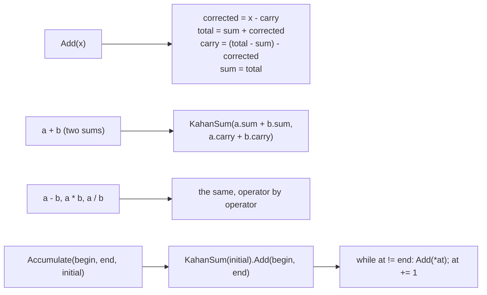

`ROOT::Math::KahanSum` is one class for every spelling a macro writes — `KahanSum<>`, `KahanSum<double>`, `KahanSum<double, 4>` — because the template arguments say how many accumulators C++ unrolls, not what the interface is. `ROOT.Math.KahanSum` is a class whose `__class_getitem__` returns itself, so both `KahanSum["double", 4].Accumulate(...)` and `KahanSum(initial)` work. Landed at `e7b52186` in `src/xrdroot/pyroot/core/kahan.py`.

## The arithmetic, from ROOT's `Math/Util.h`



Carries are combined *separately* — a carry is the rounding one sum lost, so adding two carries is as precise an answer as adding two sums. `Result()` is `Sum()`; `Add` returns `self` so a chain of adds reads as C++'s.

## Where it lives and how to test it

`pyroot/core/kahan.py`, listed in `pyroot/core/__init__.py`'s `FAMILIES` (a new family needs that *and* `__all__`), and imported into `ROOT.Math` by `pyroot/core/rmath.py`. `tests/test_pyroot_kahan.py` pins the compensation, the combining rules, the subscript identity and the default `T{}` initial value.

```bash
python -c "import xrdroot.pyroot as ROOT; v=ROOT.std.vector['double']([1e16,1.,1.]); \
print(ROOT.Math.KahanSum['double',4].Accumulate(v.begin(), v.end()))"
python -m tools.rootsuite run --root ~/src/.xrdroot-scratch/rootsrc -j 2 \
  --xrdroot-src <worktree>/src --out ~/.cache/xrdroot-runs/goal-kahan --only 'gtest/math/mathcore/testKahan'
```

`testKahan`'s seven `has no attribute KahanSum` cases are gone; its three test cases now fail on the next cause, `'int' - '_VectorIterator'`, which is a translated `std::accumulate`/iterator path rather than KahanSum.

A test function with thirteen assertions on combining rules broke the CCN ≤ 10 gate (`ccn=11`); the split into "two sums combine" and "a number combines with a sum" is the fix, not a raised limit.
