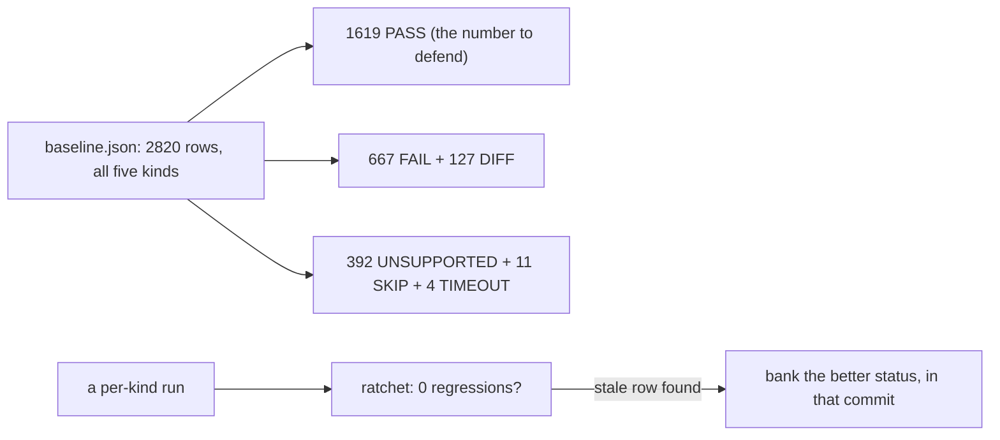

`tools/rootsuite/baseline.json` is the project's own scoreboard and it covers **all five kinds**, not one: 2820 rows — gtest 350, roottest 2173, pyunittest 129, other 109, test 59 — reading **1619 PASS, 667 FAIL, 127 DIFF, 392 UNSUPPORTED, 4 TIMEOUT, 11 SKIP**. Read it before claiming anything about "all the tests": it is the honest denominator, and a kind-specific run can be compared to it with `tools.rootsuite ratchet`.

```bash
python - <<'PY'
import json, collections, pathlib
b = json.loads(pathlib.Path("tools/rootsuite/baseline.json").read_text())
print(len(b), dict(collections.Counter(b.values())))
print(dict(collections.Counter(k.split("/")[0] for k in b)))
PY
# 2820 {'PASS': 1619, 'FAIL': 667, 'DIFF': 127, 'UNSUPPORTED': 392, 'TIMEOUT': 4, 'SKIP': 11}
# {'gtest': 350, 'other': 109, 'pyunittest': 129, 'roottest': 2173, 'test': 59}
```

## Why it matters

A `--kind pyunittest` run I made was compared against this file and **eight rows moved FAIL -> PASS** — `pyroot_array_numpy_views`, `pyroot_pyz_stl_set`, `pyroot_pyz_stl_vector`, `pyroot_root_no_implicit_cppyy`, `tpython/test_tpython`, `core/metacling/MetaClingTests`, `tmva/rbdt_xgboost`, `dataframe_snapshot_py` — work that had landed in earlier sessions and never been banked. Banking them is +8 PASS, and it costs one run and one `ratchet`, which read `0 regressions`.



## How to use it

- Quote the kind you measured, never "the suite": 102/350 gtest and 96/129 pyunittest are both true at once.
- Bank a gain from the run that showed it, in the same commit as whatever caused it.
- Never rewrite the file wholesale — replace only the rows that moved (a round-trip through `json.dumps(..., indent=2, sort_keys=True)` reformats all 2820 lines and buries the real change).
