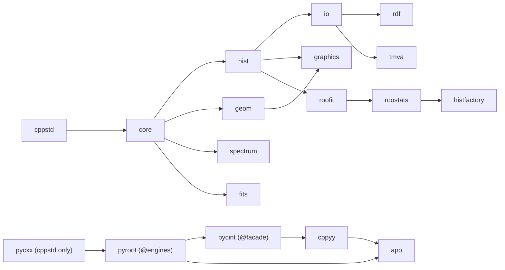

xrdroot is one distribution split into **eighteen internal components**, and the authoritative list is `pyproject.toml`'s `[tool.xrdroot.components.ownership]` — not the prose in `docs/components/`, which lags it (its index says "fifteen components" in one paragraph and "eighteen" in another).

## Read the contract, not the prose

```bash
python - <<'EOF'
import pathlib, tomllib
spec = tomllib.loads(pathlib.Path("pyproject.toml").read_text())["tool"]["xrdroot"]["components"]
for name, own in spec["ownership"].items():
    print(f"{name:12s} depends on {own.get('depends')}")
print("groups:", spec["groups"])
EOF
```

That prints the dependency each component declares and the two named groups: **`@engines`** (cppstd, core, hist, spectrum, fits, io, rdf, geom, graphics, roofit, roostats, histfactory, tmva) and **`@facade`** (`@engines` + pyroot). `python tools/components.py check` verifies every import against it; `python tools/components.py isolate cppstd core pycxx pycint` proves each imports in a fresh process with the ones above it blocked; `python tools/components.py graph` draws it.



## The eighteen

`cppstd` (generic C++: containers, streams, strings, cells) · `core` (errors, buffers, numerics, random, stats, ids, draw specs) · `hist` (histograms, graphs, functions, fitting, formulas) · `spectrum` · `fits` · `io` (files, streamers, trees, writers, RNTuple, merging, remote) · `rdf` · `geom` · `graphics` (`canvas` rasteriser and `plot` backends) · `roofit` · `roostats` · `histfactory` · `tmva` · `pycxx` (the C++→Python translator, which knows **no ROOT name**) · `pyroot` (ROOT's namespace) · `pycint` (ROOT's CINT face: macros, `.x`, `ProcessLine`) · `cppyy` (the shim) · `app` (`cli`, `__main__`, `apinamespace`).

**A lower component never imports a higher one**, and where one needs something from above the order is: return plain data and let the wrapper build the ROOT object → pass a callable in → a provider in `xrdroot.plugins` (declared in `[tool.xrdroot.components.extensions]`, each with a reason).

## Why it is worth knowing

The split exists so the components can later become separate projects, so **where a piece of behaviour lives is a design decision, not a convention**: a convenience for ROOT's users belongs in `pyroot/` (a `TString` accepted where C++ takes `const char*`), while a fact about C++ belongs in `cppstd` or `pycxx` and a fact about ROOT belongs in `pycint/dialect.py`. Getting that wrong is what the `components` gate refuses.
