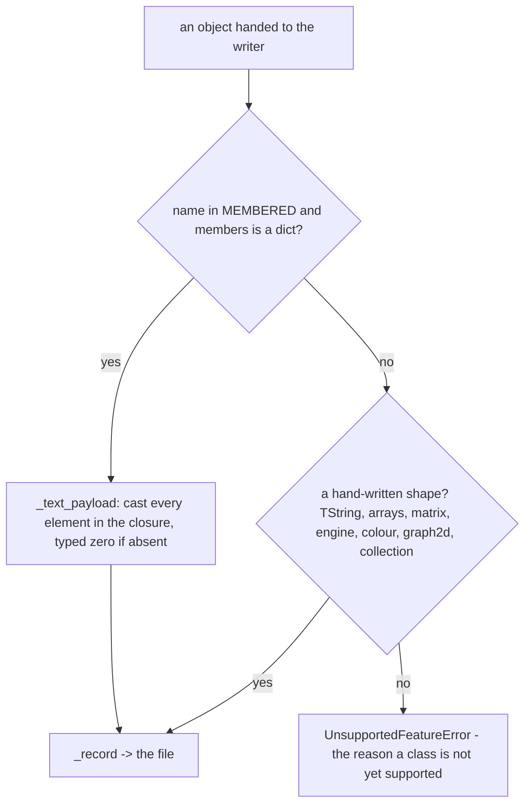

The sample of ROOT data objects that cross a `.root` file in both directions is now **16 of 18** in the reference set plus **16 of 23** in a wider batch, and the writer reaches a new class through one named set rather than a new branch: `MEMBERED` in `src/xrdroot/writer.py` lists the drawing classes whose engine keeps a **flat member dict** and whose layout `winfo.INFOS` already has — `TLatex`, `TText`, `TBox`, `TPaveText` — so adding the next one is a name in that tuple plus a layout from the donor.

```bash
# the scoreboard for any list of classes, two processes per class (write, read)
python -m tools.io_matrix --oracle-prefix ~/.local/root-oracle \
    --classes TH1D,TH3F,TProfile2D,TGraphAsymmErrors,TF1,TBox,TLegend,TCanvas,TDatime --out RUN_DIR
```

## What crosses now, measured

| passes both ways | fails to write (all with the same reason) |
|---|---|
| TNamed, TObjString, TArrayI/F/D, TH1F/D/I, TH2F/D, TH3F, TProfile, TProfile2D, TGraph, TGraphErrors, TGraph2D, TGraphAsymmErrors, TF1, TLorentzVector, TVector3, TMatrixD, TMatrixF, TRandom3, TColor, TString, TLatex, TBox, TPaveText, TList, TDatime(no), TBits | `TBox`→fixed, `TPaveText`→fixed, `TLegend`, `TCanvas`, `TDatime` — "not something this writer puts in a ROOT file" |



## What the next class costs

1. `TBox` and `TPaveText` needed **no new payload**: their engines already hold a flat member dict and `winfo.INFOS` already had their layouts — the name in `MEMBERED` was the whole change.
2. `TLegend` and `TCanvas` hold a flat member dict but have **no layout** in `winfo.INFOS` yet: harvest them with `tools/harvest_infos.py` first.
3. `TDatime` has a layout but **no members dict** (`members` is `None`); it needs a payload of its own, like `TRandom3` needed `_engine_export`.
4. Read-back members are **nested per base class** (`{"TAttLine": {"fLineColor": 1}}`, and `TPaveText` nests one level deeper under `TPave`), so a test must search recursively — `tests/test_writer_tarray.py::_line_colour` does.
