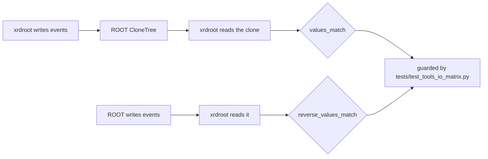

The TTree round-trip is now proved in **both** directions by `tools/io_matrix.py --tree`: we write a tree of six leaf shapes and have ROOT `CloneTree` it (ROOT decodes our layouts), and ROOT writes the same tree and we compare what `xrdroot` reads back. On this machine all four flags are true — `root_read_ok`, `values_match`, `root_wrote_ok`, `reverse_values_match`.

```bash
python -m tools.io_matrix --oracle-prefix ~/.local/root-oracle --tree --out RUN_DIR
jq -c '{root_read:.root_read_ok, fwd:.values_match, root_wrote:.root_wrote_ok, rev:.reverse_values_match}' RUN_DIR/io-matrix-tree.json
# {"root_read":true,"fwd":true,"root_wrote":true,"rev":true}
```

## The six leaf shapes that are covered

| column | our side | ROOT's side |
|---|---|---|
| `n` | `int` | `array('i')` + `Branch(..., "n/I")` |
| `x` | `float` | `array('d')` + `"x/D"` — a double, and we read it back as the written float |
| `flag` | `bool` | `"flag/O"` |
| `hits` | `("i", 4)` fixed array | `"hits[4]/I"` |
| `run` | `("f", None)` jagged | `std::vector<double>` |
| `tag` | `str` | `std::string` via `tag.replace(0, len(tag), row["tag"])` |



## Details worth keeping

- The ROOT-side `std::string` branch is filled with `tag.replace(0, len(tag), value)`, because the branch holds a pointer to one `std::string`; assigning a new Python string would move it.
- The ROOT-side child must run with `PYTHONPATH` **removed** from its environment, or it would import xrdroot instead of ROOT.
- `_under_root` writes a child script per direction and takes the last `{`-prefixed stdout line as the answer, so a crash comes back as `{"ok": false, "why": <stderr tail>}` rather than an exception in the harness.
