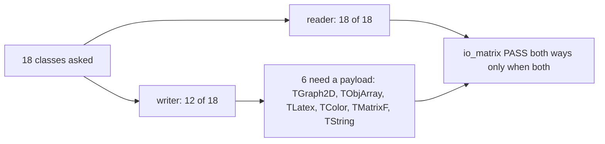

A wider sample than the twelve-class base set gives the first honest ratio for "all the data objects": of eighteen common classes asked of `tools/io_matrix.py`, **twelve cross the file boundary both ways** and six fail in the write column only — `TGraph2D`, `TObjArray`, `TLatex`, `TColor`, `TMatrixF`, `TString`. `winfo.INFOS` holds 88 classes and `ARRAY_LAYOUTS` another 6, so a layout existing is not the same as a payload existing.

```bash
python -m tools.io_matrix --oracle-prefix ~/.local/root-oracle \
    --classes TH1D,TH3F,TProfile2D,TGraphAsymmErrors,TGraph2D,TEfficiency,TF1,TMultiGraph,\
TNtuple,TList,TObjArray,TLatex,TColor,TMatrixF,TVector3,TLorentzVector,TArrayF,TString \
    --out ~/.cache/xrdroot-runs/io-wide
# 12 of 18 classes cross the boundary both ways
```

## The two columns mean different things

| column | what it proves |
|---|---|
| ROOT -> xrdroot | the *reader* handles the class — 18 of 18 here, because the reader works from the file's own descriptions |
| xrdroot -> ROOT | the *writer* has a payload for it — 12 of 18, because a payload is hand-written per shape |

So the gap list is a *writer* list: each failing class needs a row built from its accessors (`writer.py`'s `_shaped_payload` chain) or, where the object keeps its state privately, an export like the random engines'.



## How to use the number

Quote it as a ratio with the class list beside it, never as a percentage of ROOT. `winfo` holds 88 layouts, so 88 is the ceiling for "writer knows the shape" today; anything beyond that needs a donor and `tools/harvest_infos.py` first. The order that pays is the one in `docs/instructions/the-four-step-recipe-for-adding-a-class-to-file-io.md`, and the cheapest next six are the ones named above, each already readable.
