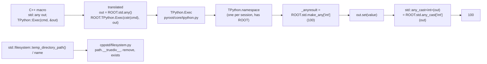

`TPython::Exec` and `std::any` are what `bindings/tpython` tests; both were missing, and with them landed `std::filesystem`, which the four `LoadMacro*InName` cases need to name their temporary macro files. `gtest/bindings/tpython/testTPython` (five cases) and `pyunittest/bindings/tpython/test_tpython` PASS at `b3fccdd4`.



## What each piece is, and where

| C++ | here |
|---|---|
| `std::any a;`, `has_value`, `type`, `reset`, `value` | `AnyValue` in `src/xrdroot/cppstd/stdlib.py`, `ROOT.std.any()` |
| `std::make_any<int>(v)` | `ROOT.std.make_any['int'](v)` — the subscript names the type |
| `std::any_cast<int>(a)` | `ROOT.std.any_cast['int'](a)`, converting through `_TYPE_CONVERTERS` |
| `TPython::Exec`, `Eval`, `LoadMacro`, `ExecScript` | `src/xrdroot/pyroot/core/tpython.py`, gathered by `pyroot/core/__init__.py`'s `FAMILIES` as `"tpython"` |
| `std::filesystem::path`, `temp_directory_path`, `remove`, `exists`, `create_directories`, `file_size`, `is_regular_file`, `is_directory`, `current_path` | `src/xrdroot/cppstd/filesystem.py`, `ROOT.std.filesystem` |

`TPython.namespace` is a `ClassVar` **kept for the session**, as ROOT's is: a second `Exec` sees the first one's names, which is why `TPython::Exec("arr = []")` then a hundred `Exec("arr.append(i)")` from threads works. It is seeded with `ROOT` on first use.

## The translator's output was already right

`std::any out;` becomes `out = ROOT.std.any()`, `cmd.str().c_str()` becomes `cstr(cmd.str())`, `&out` loses its `&` (a `std::any` is mutable here, so `TPython.Exec` can set it), and `std::filesystem::temp_directory_path() / (a + b)` becomes `div(temp_directory_path(), a + b)` — the runtime's `div` is `fdiv` for non-integers, which is `a / b`, so `path.__truediv__` is what makes that line work. Check a translation with:

```bash
python -c "import xrdroot.cint as c; print(c.translate(open('m.C').read()))"
```

## Two traps

- `class Any` collides with `from typing import Any` in `stdlib.py` (ruff F811); the class is `AnyValue` and `ROOT.std.any` names it. A class-level mutable dict needs `ClassVar[...]` or ruff's RUF012 fires.
- A new `pyroot/core/*.py` family must be in `FAMILIES` (`pyroot/core/__init__.py`) **and** carry `__all__`, or `core._gather` raises `AttributeError: module ... has no attribute '__all__'` at import time.

`std::filesystem::remove` answers `False` where C++ throws (a missing path, a directory with something in it): a program that asks `exists` first is the case this exists for.
