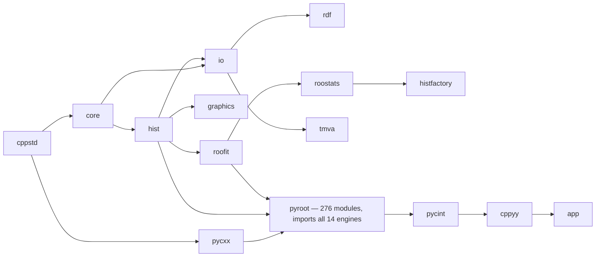

The internal split is finished and enforced, but the physical layout does not match it, and two numbers show what a distribution split would have to fix first. `pyproject.toml`'s `[tool.xrdroot.components]` declares eighteen components, `tools/components.py check` reports 12 190 imports with zero undeclared ones, and `tools/components.py isolate cppstd | pycxx | hist | io | roofit` imports each engine in a fresh process with everything above it blocked.

## What the boundaries actually look like (measured 2026-11-22)

- **1 025 modules, 146 020 lines** in `src/xrdroot`: 75 flat modules beside 25 packages. `core` (26), `hist` (21) and `io` (32) module names live *flat* — there is no `xrdroot.io` or `xrdroot.core` package — while `roofit` (159), `tmva` (80), `pycxx` (69) and `pyroot` (276) are packages. Packages come first in any split.
- **The facade carries everything**: `python -c "import xrdroot.pyroot"` loads **684 modules in 536 ms**, against **64 modules in 5 ms** for `import xrdroot`; `xrdroot.roofit` alone is 65 modules/5 ms because engines import lazily. So installing one component today still pays for all of them.
- **Cross-cutting infrastructure lives in `core`**: `plugins.py` (42 declared extensions over 37 points), `errors.py`, `library.py` (the `pip install` refusal text naming every optional package), `display.py`, `notebook.py`. That is the thin shared base a multi-dist project needs, not "primitives".
- **The tests are flat**: 667 files in `tests/` (pyroot 154, roofit 111, cint 51, tmva 38), so no component carries its own suite or coverage gate today.
- **`xrdroot` is one dist with 13 extras** (`plot`, `plotly`, `numba`, `bokeh`, `hep`, `lz4`, `zstd`, `fit`, `geom`, `tmva`, `distrdf`, `dev`, `docs`), which is already how a user chooses what to install.

## The decision this supports

Split out only what is independently useful and already isolated — `cppstd` (numpy only) and `pycxx` (cppstd only), the C++-standard-library and C++-translator products — and never split `pyroot`/`pycint`/`cppyy`/`app`, which are the ROOT-compatible surface and import everything by construction. `io` and the `roofit`/`roostats`/`histfactory` stack are the plausible next candidates, but only after four prerequisites: those flat modules become packages; `plugins`/`errors`/`library`/`display` become a shared base dist; tests move per component with their own gates; and the facade imports engines lazily. A multi-distribution cutover was already tried and replaced by internal modularisation in Oct 2026 — `docs/history/modularisation-plan-2026-10.md` — so revisit it only with those prerequisites in hand.
