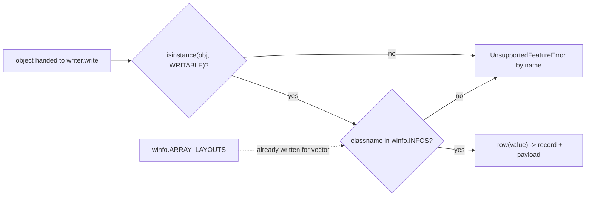

Adding a new class to xrdroot's writer takes **two** entries, not one: an xrdroot object type in `WRITABLE` at `src/xrdroot/writer.py:166` (today `(Histogram, Graph, Efficiency, Function, MultiGraph)`), and that class's streamer layout in `winfo.INFOS`, which `writer.py:1314` refuses by name when it is absent. The `TArray` layouts already exist in `winfo.ARRAY_LAYOUTS` — they are used to write a `vector<TArrayD>` inside a `TGraphMultiErrors` — so a standalone `TArrayD` key is dispatch work, not layout work.

```python
# src/xrdroot/writer.py:166
WRITABLE = (Histogram, Graph, Efficiency, Function, MultiGraph)
# src/xrdroot/writer.py:1314, inside _object_payload
if classname not in INFOS:
    raise UnsupportedFeatureError(f"a {classname} is not a class this writer carries a layout for; ...")
```

## What each refused class needs

| class | work |
|---|---|
| `TArrayC`/`S`/`I`/`L64`/`F`/`D` | dispatch + key only: `winfo.ARRAY_LAYOUTS` has the layout |
| `TLorentzVector` | layout `fP` (a `TVector3`) + `fE`, then dispatch |
| `TMatrixT<double>` | rows/columns + a `TArrayD` of elements |
| `TRandom3` | its Mersenne state (`fMt`, `fCount`, …) — the least trivial of these |



## How to check the work

`python -m tools.io_matrix --oracle-prefix ~/.local/root-oracle --classes TArrayD,TLorentzVector` — the class is supported only when both directions agree on the name ROOT reports. Do not trust a layout that merely writes without error: a wrong member order or version produces a file ROOT reads back *wrong* rather than not at all.
