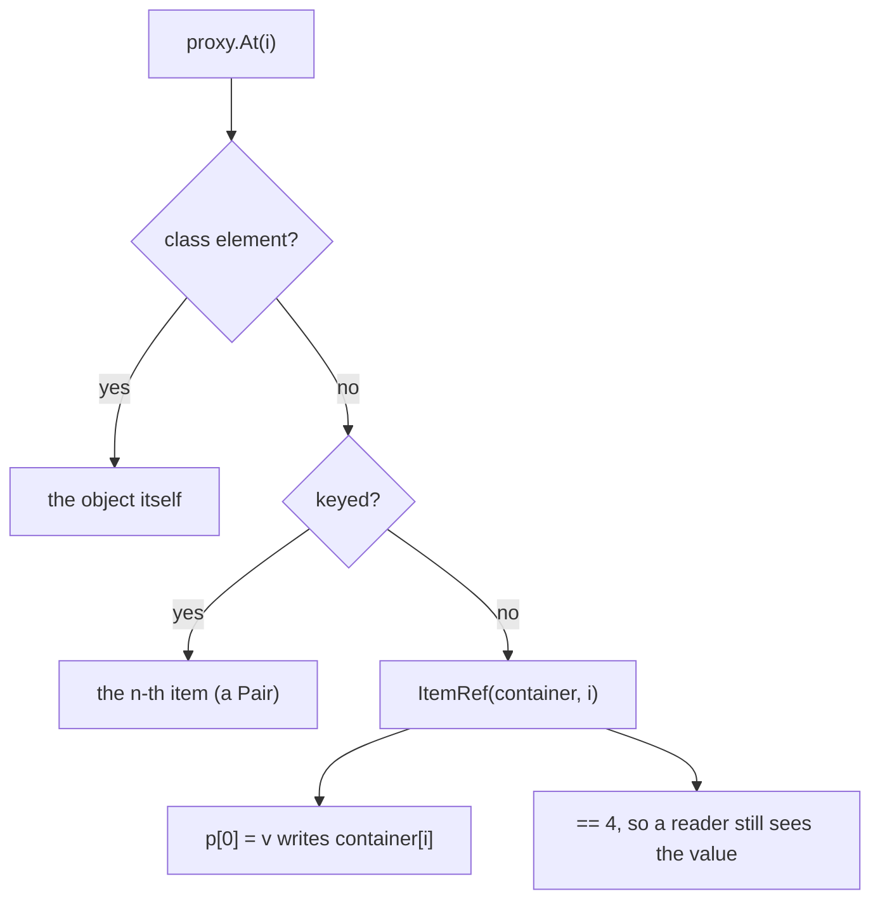

When a runtime accessor is read as a **value** by the kit's own tests and written through as an **address** by a macro, the reconciliation is an object that is both — an `ItemRef` that compares equal to the value it points at — not a choice between the two, and not a test rewritten to fit the code.

## The disagreement

ROOT's `TVirtualCollectionProxy::At(i)` answers a `void *`, and roottest's generator writes through it:

```cpp
proxy->Allocate( genInt(), false );
*((int *)proxy->At(i)) = genInt();
```

This kit's `At(i)` answered the **value**, and two of its own tests pin that:

```python
(proxy.Size(), proxy.At(0), proxy.At(3)) == (1, 4, None)        # a number
(3, mapped.At(0)) == (3, (1, 2.0))                              # a map's first pair
```

Changing `At` to an address broke them; leaving it a value left the write with nothing to land in (`'int' object does not support item assignment`). Round 136 hit exactly this, reverted, and left the tests as the specification.

## The shape that satisfies both

`cppstd.cells.ItemRef(container, key)` already existed for `&v[i]`; give it equality with the value it points at:

```python
def __eq__(self, other):
    value = self.value
    if value == other:
        return True
    from .objects import Pair
    return isinstance(value, Pair) and tuple(value) == other
```

Then `At(i)` may answer an `ItemRef` for a slot a program writes into — `p[0] = v` lands in the container — and every reader that compares `At(0)` with `4` still sees `4`. The pair arm covers a keyed container, whose n-th item is a `Pair` compared against the `(key, value)` tuple ROOT prints.



## The other three pieces of the same fill

- `Allocate(n)` must **refill the container it holds**, not require a Python `list`: the guard pushes the macro's own `vector<int>`, so `_refill` clears and `push_back`s (a list takes the slice).
- `TClass::GetCollectionProxy` is **null for a `pair`, an `array` and a `bitset`** — containers of a kind, not *collections* — or a program fills a pair element by element as though it were a vector.
- `byte_offset` **steps an `ObjectAddress`** as the object it holds, which is what `char_pointer(rcl.New())` hands a walker.

## How to check it

```bash
export PYTHONPATH=$PWD/src
.venv/bin/python -m pytest -q tests/test_pyroot_collections.py tests/test_pyroot_reflection.py
.venv/bin/python -m pytest -q tests/test_pyroot_collections.py -k 'proxy_allocates' -v
```

Two tests, both passing at once, is the whole point: the kit's reader-facing expectations and the macro's write path are not in conflict once the accessor is an object rather than a bare value.
