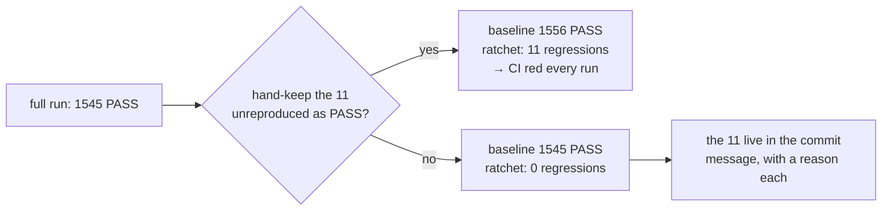

`tools/rootsuite ratchet` fails on any entry the baseline calls PASS that the run does not reproduce, so hand-keeping an unreproducible PASS and banking a measurement are in direct conflict: the first keeps the number flattering and makes the gate red, the second lowers the count and lets the gate mean something. Bank the run's own statuses, and explain the entries it does not reproduce in the commit message instead of in the file.

## Why hand-keeping cannot work

Banking a run rewrote the baseline to 1545 PASS from 1495, and 12 of them were not reproduced. Hand-keeping those 11 back to PASS made `ratchet` report **11 regressions** — the same 11 — because a hand-kept PASS is by definition one no run produced. Banked as measured, the same run reports `0 regressions`, and the count still rose by 50.



## The exact commands

```bash
python -m tools.rootsuite run --root ROOTSRC --jobs 4 --xrdroot-src TREE/src --out RUN_DIR
python -m tools.rootsuite baseline RUN_DIR/results.json     # rewrites the whole file
python -m tools.rootsuite ratchet RUN_DIR/results.json      # must say 0 regressions
```

`baseline` rewrites every entry, so check the PASS count before and after (`jq '[.[]|select(.=="PASS")]|length'`), and confirm the ratchet against the same run — a baseline nobody ratcheted is a number without a gate.

## Triage what did not reproduce, then say so where it is read

Five needed CERN's network (`root://eospublic.cern.ch`, a `TWebFile`), three passed alone and differed inside the four-job run, three were a pre-existing divergence from ROOT, one needed threads. Each reason went into the commit message, which is where a reader looks when the number changes: the baseline file holds statuses only, and inventing a comments sidecar for it would put the explanation somewhere the tool rewrites.
