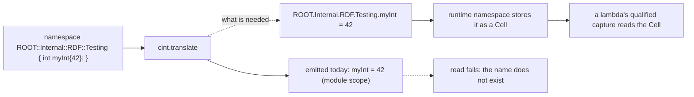

When translated C++ declares a variable inside a namespace, the Python emitted for it is a plain module-level assignment: the namespace is thrown away. So a ROOT-owned namespace that the translator is expected to populate as an attribute path — `ROOT::Internal::RDF::Testing::myInt` — is never assigned, and a later read of `ROOT.Internal.RDF.Testing.myInt` reports that the name does not exist.

```python
from xrdroot import cint
print(cint.translate("namespace ROOT::Internal::RDF::Testing { int myInt{42}; }", "d.C"))
```

```
from xrdroot.pycint.runtime import *
myInt = 42
```

## Why it matters

`ROOT::Internal::RDF::Testing` holds the values an interpreted RDataFrame test sets and reads back across a compiled/interpreted boundary (`dataframe_compgraph` is one). Two links of that chain exist already: the runtime namespace object stores each value as a `Cell`, and a lambda capture that binds a *qualified* name takes the cell (`pycxx/emit_funcs.py`'s `_shared_cell`). Only emission is missing.



## What to do

A namespace-scope global declared inside a `ROOT::`-owned namespace must be emitted as the dotted attribute — `ROOT.Internal.RDF.Testing.myInt = 42` — rather than as a bare module global. The name folding lives in `pycxx/emit_vars.py` / `emit_module.py`. Namespaces xrdroot does not own can keep the flat name, since nothing addresses them by path.

## How to check

The probe above, then `dataframe_compgraph` in its own worktree:

```bash
cd "$OUT/work/tree/dataframe/test" && PYTHONPATH=<worktree>/src python -m xrdroot run dataframe_compgraph.cxx
```
