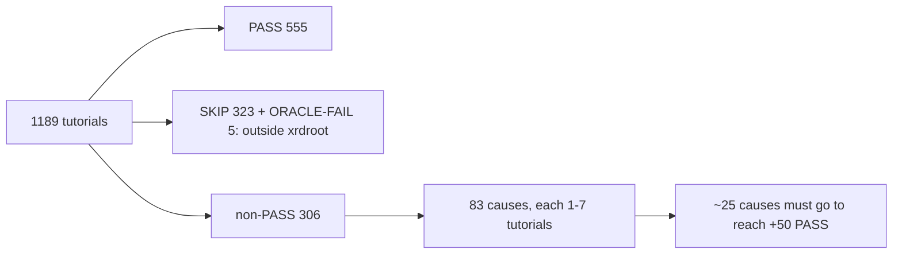

A fresh full tutorials run against `origin/main` gives **PASS 555, DIFF 130, FAIL 78, UNSUPPORTED 88, SKIP 323, ORACLE-FAIL 5, FLAKY 10** out of 1189 — slightly *below* the committed baseline's 564, and the non-PASS set is an 83-cause long tail with **no single cause worth more than 7 tutorials**. So "another +50 tutorials" is roughly 25 API additions, not one fix, and it must not be measured with `--only`.

```bash
python -m tools.tutorials run --tutorials ~/src/.xrdroot-scratch/rootsrc/tutorials --jobs 10 \
    --oracle-prefix ~/.local/root-oracle --xrdroot-src $PWD/src --out RUN_DIR
# 25 minutes on 18 cores; RUN_DIR/triage.md lists every cause with its tutorials
```

## The ranked worklist (from RUN_DIR/triage.md)

| tutorials | cause |
|---|---|
| 7 | `*Entries : N : Total = M bytes*` in `TTree::Print` — the byte total differs per tutorial, and `staff.py` differs at the data level too |
| 7 | a Python tutorial dying in `runpy` (the class it needs is missing) |
| 6 | `timeout` — df101, df102, rs401d |
| 4 | `ROOT.RooLagrangianMorphFunc` |
| 3 each | a missing `.Write`, `.axes`, `.reduce`, `.getMin`, `.size` |
| 2 each | `RDF.SaveGraph`, `RDF.Experimental.FromSpec`, `TMultiLayerPerceptron`, `TF1Convolution`, `TFoamIntegrand`, `RooSimWSTool`, `RooMomentMorphFuncND`, `RooPolyFunc`, `RooStats::SPlot`, `RooJeffreysPrior`, `AndersonDarlingTest`, `GetCurrentMacroName`, `GetListOfBrowsables` … |



## Traps found while measuring

- **The baseline is not beaten by a fresh run.** 555 against the committed 564 means the last runs were better than this machine-state run (10 FLAKY included), so a `ratchet` here would fail; never bank a number from a flaky or loaded run.
- The `Total = N bytes` group looks like one fix and is not: the byte deltas differ in sign and size per tutorial (tree122 off by 16, tree107 by 8819, `staff.py` by 126 000), so each is its own data-level question.
- `triage.md` in the run directory is the worklist to grind; regenerating it needs nothing but `results.json` and the regexes for `missing ROOT…` and `has no attribute '…'`.
