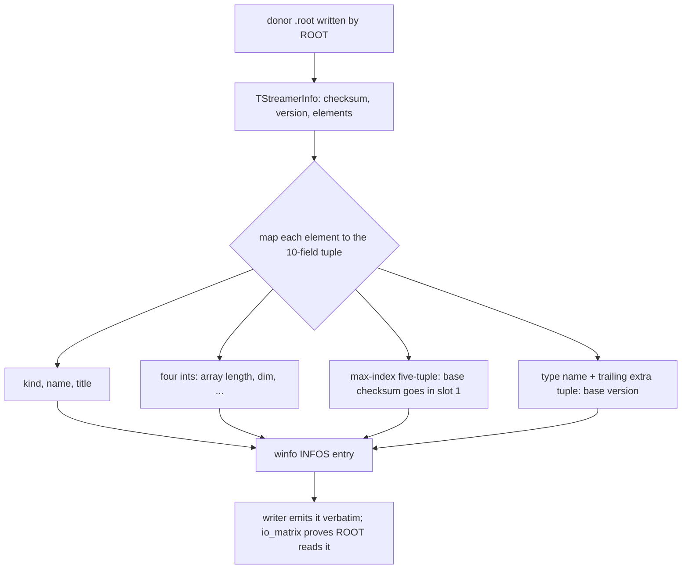

Harvesting a layout means filling a 10-field tuple, and the fields are easy to get wrong because four bare integers sit beside a five-tuple of max indices. `winfo.py:146` defines `Element = tuple[str, str, str, int, int, int, int, tuple[int, ...], str, tuple[object, ...]]`, and a real entry makes the mapping concrete: `('TStreamerBase', 'TH1', '1-Dim histogram base class', 0, 0, 0, 0, (0, 473383108, 0, 0, 0), 'BASE', (8,))` — kind, member name, title, four integers, the max-index five-tuple (which carries the base's checksum in slot 1), the type name, and an extra tuple holding the base's version.

```python
# src/xrdroot/winfo.py:146 and :200
Element = tuple[str, str, str, int, int, int, int, tuple[int, ...], str, tuple[object, ...]]

"TH1C": (0x36f6e4ad, 3, (
    ('TStreamerBase', 'TH1', '1-Dim histogram base class',
     0, 0, 0, 0, (0, 473383108, 0, 0, 0), 'BASE', (8,)),
    ('TStreamerBase', 'TArrayC', 'Array of chars',
     0, 0, 0, 0, (0, -1366845130, 0, 0, 0), 'BASE', (1,)),
)),
```

## Why a harvester cannot be improvised

Two different things must agree before a generated entry is safe:

1. **what ROOT says** — from a donor file's `TStreamerInfo`: checksum, class version, and per element the streamer type, name, title, array length and the `GetMaxIndex` values;
2. **what `winfo` expects** — the tuple above, where a base's element carries the base's checksum inside the max-index tuple and its version in the trailing tuple, and where the class checksum at `winfo.py:54` is *derived* rather than read.



## How to check a generated entry

`python -m tools.io_matrix --oracle-prefix ~/.local/root-oracle --classes <Class>` must read PASS in both columns. The writer emits what the table says with no interpretation, so a wrong field produces a file ROOT decodes as different values, not an error — the tool is the only check that catches it.
