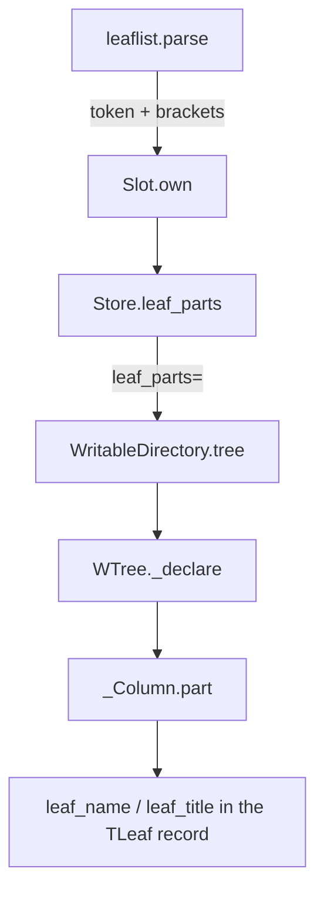

A leaflist names the *leaf*, not the branch, and keeps its brackets — and where a namespace declared in an `#include`d header is looked for decides whether `ROOT.NS.Class()` exists at all. Both are one-line misunderstandings with a file-format consequence.

On the oracle, `t.Branch("myint1b", &i, "myint1balias/I")` writes `branch [myint1b] title=[myint1balias/I]` holding `leaf [myint1balias] title=[myint1balias]`, and `t.Branch("array2Db", a2, "array2Db[10][2]/F")` writes `branch [array2Db] title=[array2Db[10][2]/F]` with `leaf [array2Db] title=[array2Db[10][2]] len=20`. Rebuilding the leaf title from the column's length — `name[len]` — loses the dimensions, and a reader then has nothing to shape a static array by, so the value comes back flat where ROOT gives `(10, 2)`.

## The same trap twice: asked of the text, not of the source

`ROOT.gInterpreter.Declare('#include "TreeHelper.h"')` runs a text of *declarations*, and the code that decided "does this declare namespaces?" looked for the word in the argument. An `#include` has none, so the namespaces its translation declared were never registered — while the classes in them were, by a different path, which is why the failure looked arbitrary. Check for `#include` too, or ask the parse (`pycint.library.translate.declared_in` already expands includes).

## What to check when a written tree reads back differently from ROOT

1. Print the oracle's `GetListOfBranches()`/`GetListOfLeaves()` names, titles, `fLen`, `fLenStatic` and `fOffset` for the same calls (`…/probe/l2.C`), and compare them field by field.
2. A leaf's *title* is where a `TLeaf` keeps a static array's dimensions; only `TLeaf::GetLenStatic` and the title carry them.
3. `Slot.own` is `None` for a branch of objects or of clones — neither is given a leaf list — so read it with `getattr` rather than assuming every slot has it.
