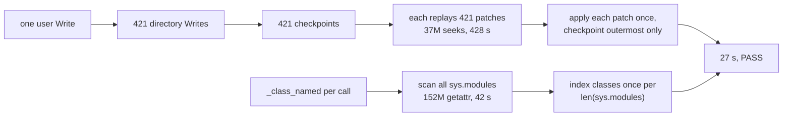

Merging a long-lived branch cost two harness PASSes, and both were found only by re-running the lost tests alone rather than by reading the merge: one was a lost name-based check, the other was quadratic code that a new feature had multiplied. The transferable part is where the time went — 509 s and 105 s profiles showing millions of `seek()` and `getattr` calls — and the habit of profiling a slowdown instead of guessing at it.

## The two failures, and what each looked like

`roottest/root/treeformula/stl/SparseSelection` failed on one extra stderr line, `Warning in <TClass::Init>: no dictionary for class ROOT::TIOFeatures is available`. The merge had replaced a regex on the class name (`^(T[A-Z]|Roo|ROOT::|…)`, which suppressed every ROOT-looking name) with knowledge-based checks against the kit's tables, and knowledge alone cannot see `ROOT::TIOFeatures`, which the kit implements nothing of. A namespace prefix is the safe half of the old heuristic: a class in `ROOT::` is ROOT's, while a bare name proves nothing. `TVirtualIndex` needed the same treatment and went into `ROOT_CLASSES`.

`roottest/root/io/directory/execmanydirs` went from 162 s to over 300 s alone. `cProfile` said 37 million `BufferedWriter.seek` calls inside one function:

```bash
python -m cProfile -o prof.out -m xrdroot root -q -b 'execmanydirs.cxx(20)'
python -c "import pstats; pstats.Stats('prof.out').sort_stats('tottime').print_stats(8)"
```

Two causes, both quadratic:

- `TFile::Write` checkpoints the file so it is readable at once. A directory's `Write` writes its subdirectories, so one user-level `Write` recursed through 421 directories and checkpointed at each — and each checkpoint re-applied every patch, so a patch list of 421 entries was replayed 421 times. Applying each patch once, and checkpointing only at the outermost `Write`, took `n=20` from 509 s to 4.7 s.
- `_class_named` scanned every module in `sys.modules` on every call (152 million `getattr`s, 42 s of a 105 s profile at `n=60`). Indexing the namespace's classes once per import-count took `n=200` from 437 s to 27 s — and `n=20` to 1.2 s, faster than the 2.9 s before the merge.



## What to do with this

A merge that touches the writer or reflection will change cost, not just behaviour, and no gate times anything. When a harness test that used to pass starts failing as TIMEOUT, profile the program it runs at a small size before touching the timeout — the fixed 300 s cap is what makes the regression visible, and raising it would have hidden both of these.
