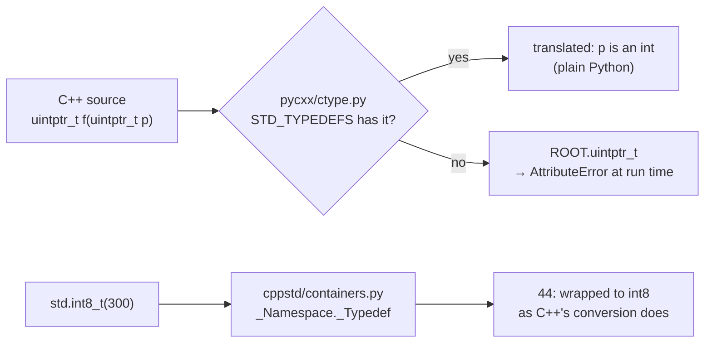

`ROOT has uintptr_t; xrdroot.pyroot does not yet` is not a missing ROOT class — it is a **standard-library typedef** the translator had not been told about, so `uintptr_t f(uintptr_t p)` fell back to `ROOT.uintptr_t`. The four pointer-/maximum-width typedefs (with their `std::` spellings) are now in `STD_TYPEDEFS`, and the fixed-width names convert as calls on the namespace. `cppyy/test_fragile` went from 26 failing cases to 13 at `41116040`.



## Two tables, two jobs

| where | what it is for |
|---|---|
| `src/xrdroot/pycxx/ctype.py` `STD_TYPEDEFS` | **translation**: the type a spelling stands for. A name missing here becomes `ROOT.<name>` and the macro is refused at run time. |
| `src/xrdroot/cppstd/containers.py` `NUMBERS` | **runtime**: the NumPy dtype an element type is stored as. |
| `cppstd/containers.py` `_Namespace` | **runtime**: `ROOT.std.int8_t(x)`, the conversion C++ writes as a call. |

A name needs the first to translate and the second (or the third) to run; `size_t` and `ptrdiff_t` were in both, `intptr_t`/`uintptr_t`/`intmax_t`/`uintmax_t` in neither. To add one: the entry in `STD_TYPEDEFS` (both spellings), the entry in `NUMBERS`, and — if a program writes `std::name(x)` — the `_Typedef` line on `_Namespace`.

## What a conversion has to do

`std::int8_t(300)` is **44** in C++ — the value wraps to the type's width and sign — so `_Typedef.__call__` casts through the dtype rather than returning the number. `std::int8_t('a')` is **97**: a one-character string converts by its code point, which is what the translator produces for `'a'`.

## How to check

```bash
python -c "import xrdroot.pyroot as ROOT; print(ROOT.std.int8_t(300), ROOT.std.uintptr_t(300))"
python -c "import xrdroot.cint as c; print(c.translate('uintptr_t f(uintptr_t p){return p+1;}'))"
python -m tools.rootsuite run --root ~/src/.xrdroot-scratch/rootsrc -j 2 \
  --xrdroot-src <worktree>/src --out ~/.cache/xrdroot-runs/goal-typedef \
  --only 'pyunittest/bindings/pyroot/cppyy/cppyy/test_fragile'
```

What `test_fragile` still needs is cppyy's own layer — `cppyy.gbl` namespaces, module imports, `__bool__` on operators, enum pickling — which is the semantics block, not typedefs.

`rg` note: a search for `int8_t` in `pycxx/` shows matches as `n` in this harness's output; read the file rather than trusting the match text.
