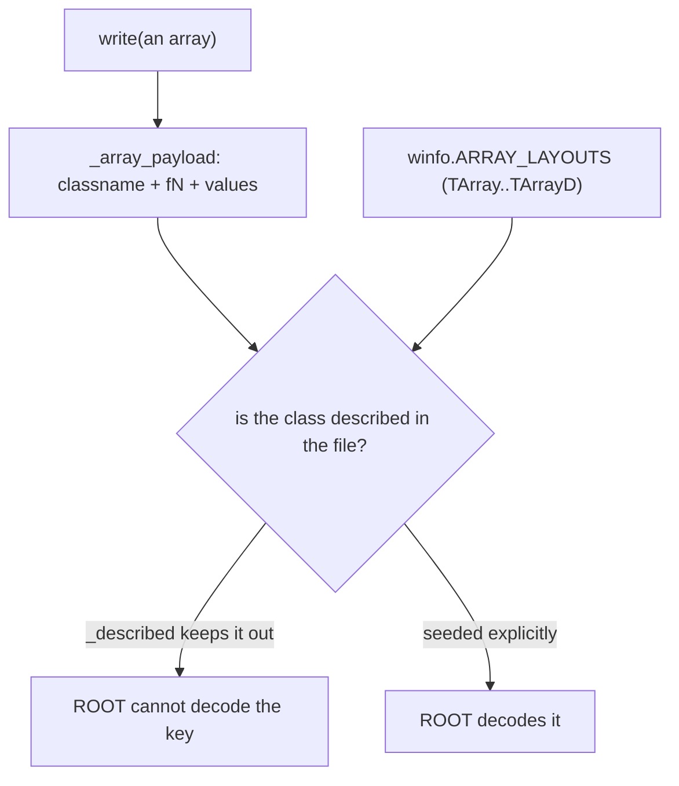

A `TArray` has no streamer of its own: `TArray::Streamer` writes a counter and that many values and nothing round them, and xrdroot's writer mirrors that. But a *standalone* `TArrayD` key still needs the file to describe the class, and `writer.py`'s `_described` deliberately keeps arrays out of a file's streamer information unless a class that holds one pulls them in. So making `TArrayD` a writable key is not one dispatch entry: it is a dispatch entry plus a seed in the description closure.

```python
# src/xrdroot/writer.py:765 - how an array is written today
def _arrays(buf, name, value):
    """A ``vector<TArrayD>``: how many, then each as the ``TArray`` it is.

    One of ROOT's array classes has no streamer of its own - ``TArray::Streamer`` writes
    the counter and that many values - so an element here is those two and no record.
    """

# src/xrdroot/writer.py:940 - and why a bare array is not described
def _described(owner, name, stype):
    if stype in STL_STYPES:
        return name in ARRAY_LAYOUTS
    if name in INFOS:
        return True
    return owner in ARRAY_LAYOUTS and name in ARRAY_LAYOUTS
```

## Why it matters

`INFOS` does not contain `TArrayD` at all; the layouts live in `winfo.ARRAY_LAYOUTS` and are resolved through `writer.py:582` (`INFOS.get(name) or ARRAY_LAYOUTS.get(name)`). Anything that assumes "add it to `INFOS`" will not work for the array family, and anything that assumes "the layout is enough" will write a file whose class is undescribed — readable by xrdroot, not by ROOT.



## How to check

`python -m tools.io_matrix --oracle-prefix ~/.local/root-oracle --classes TArrayD` — the ROOT side is what decides; xrdroot reading its own file back proves nothing here.
