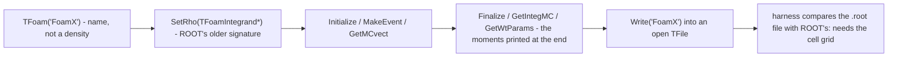

`foam_demo.C` cannot pass until a `TFoam` can be written into a ROOT file, and that is a subsystem rather than a patch: the tutorial samples 50 000 events, then calls `FoamX->Write("FoamX")` into a `TFile RootFile("foam_demo.root","RECREATE")` opened before the foam, and the harness compares that written file with ROOT's. Reproducing it means a real `TFoam` streamer **and** FOAM's adaptive cell grid, bin for bin.

```bash
# where it stops, and why
python -m tools.tutorials run --tutorials ~/src/.xrdroot-scratch/rootsrc/tutorials --jobs 1 \
  --oracle-prefix ~/.local/root-oracle --xrdroot-src $PWD/src \
  --out ~/.cache/xrdroot-runs/tut-foam --only math/foam/foam_demo.C
rg -n "Write|RootFile|SetRho" ~/src/.xrdroot-scratch/rootsrc/tutorials/math/foam/foam_demo.C
```



## What the API had to match, and one thing it cannot

| the tutorial says | what xrdroot needed |
|---|---|
| `new TFoam("FoamX")` | the constructor takes the **name**, not an integrand — passing a string as the density made `Initialize` die on `str` |
| `TFoamIntegrand *rho = new TFDISTR(); FoamX->SetRho(rho)` | `SetRho` in ROOT's **older** form takes the density; `float(rho)` failed with `float() argument must be … not 'TFDISTR'` |
| `Finalize(IntNorm, Errel)`, `GetIntegMC(...)`, `GetWtParams(...)` | the integral, its relative error and the weight moments - returned as tuples here, since a Python call cannot write through ROOT's references |
| `FoamX->Write("FoamX")` | **refused in a sentence**: no `TFoam` streamer exists, so the foam cannot be read back out of a file |

## The decision to make before writing it

Harvest `TFoam`'s streamer from a donor (the three-step recipe) or refuse persistency for good. If the grid must match ROOT's cell decomposition exactly for the file comparison to pass, the honest options are a real FOAM port or a scope label — not a stub that writes a file nobody can read.
