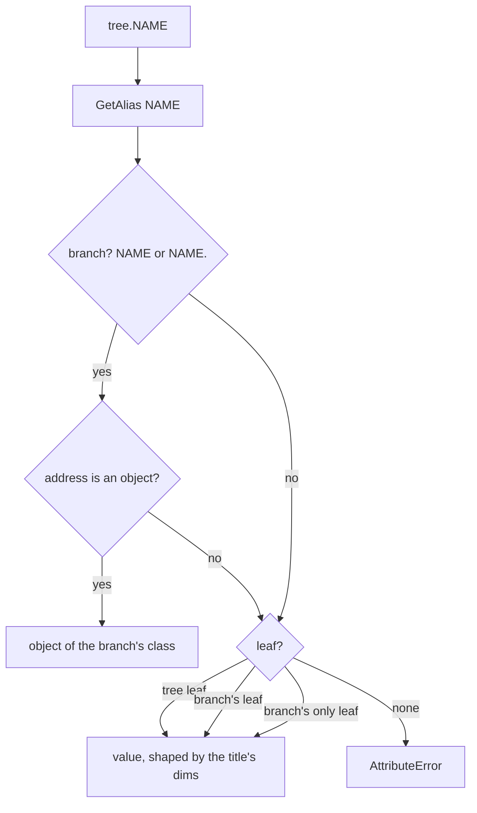

PyROOT's `TTree.__getattr__` is a thin Python function over a C++ helper, and that helper's **order** is the whole behaviour: alias, then branch, then leaf. Reading only the leaf half (as this kit did) gives a struct branch as a dict of members and no way to reach a leaflist's leaf.

`bindings/pyroot/pythonizations/src/TTreePyz.cxx:187`'s `GetBranchAttr` does, in order: `tree->GetAlias(name)` (an alias wins over a branch of the same name); `tree->GetBranch(name)` or `GetBranch(name + ".")` — *"for benefit of naming of sub-branches, the actual name may have a trailing '.'"*; and only then a leaf, by `tree->GetLeaf(name)`, then `branch->GetLeaf(name)`, then the branch's **single** leaf *"if unambiguously only this one"*. A branch answers `*(void **)branch->GetAddress()` cast to `branch->GetClassName()`, and a leaf's value is shaped by the dimensions `getMultiDims` parses out of its **title** (`array2Db[10][2]` is a `(10, 2)` view).

## What to watch for when copying a pythonization

1. **Read the C++ helper, not only the Python.** `_ttree.py` is 20 lines and all of the substance is in `TTreePyz.cxx`.
2. **A leaf's *title* is where a static array's dimensions live** — a `TLeaf` has no other way to say them, and this kit's writer flattened `array2Db[10][2]` to `array2Db[20]`, which left the reader nothing to shape.
3. **A leaflist can name its leaf differently from its branch** — the oracle writes `branch [myint1b] title=[myint1balias/I]` holding `leaf [myint1balias]` — so a lookup that only knows branch names misses it.
4. The same trap a second time: **the oracle settles a name**. One macro that writes the tree and prints `GetListOfBranches`/`GetListOfLeaves` names and titles answered four questions at once (`…/probe/l2.C`).
