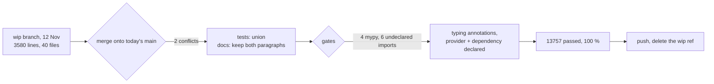

A branch can be "unfinished" only in the sense that nobody ran the gates on it, not that its code is incomplete. The held R2 lane — `RooWorkspace::writeToFile`, named in `AGENTS.md` as wanted work — sat on `wip/r2-workspace-write-20261112` for eleven days with a commit message saying it had never passed the gates. Merged onto today's `main` it passed the full suite on the first try (13757 passed, 100 % line and branch) and needed three small fixes, all of them structural rather than functional.

## What "finish it" actually took



1. `tests/` conflicts are additive → `git merge-file --union`. `docs/` conflicts were two true paragraphs about different features → keep both; deleting either loses a documented behaviour.
2. The real blocker was architectural: `xrdroot/roofit/workspace.py` imported `xrdroot.pyroot.core.directories`, a layer **above** `roofit`, which `tools/components.py check` reports as an undeclared edge. The fix is the sanctioned one — declare a provider and ask for it:

```python
('roofit.current_directory', 'default'): (
    'pyroot', 'xrdroot.pyroot.core.directories', 'current_directory',
),
```

plus `{ caller = "xrdroot.roofit.workspace", point = …, provider = "pyroot", target = … }` in `[tool.xrdroot.components]`'s `extensions`, and `io` added to roofit's `depends` (io is below roofit, so that edge is legal).

3. mypy's four errors were all `Any` leaking out of a dict of streamed records. Annotating the local (`held: dict[str, Any] = found`) fixes it, and so does `def unsupported(value: Any) -> NoReturn` — a function that always raises should say so, and then the caller's `return unsupported(...)` narrows instead of returning `Any`.

## The lesson worth keeping

Check what a WIP branch *is* before assuming the work is hard: here the code was complete and the only work was the gate it never ran. A branch blocked on `provider-undeclared` plus `no-any-return` looks unfinished and is an afternoon of typing; a branch whose patches no longer apply is genuinely stale.
