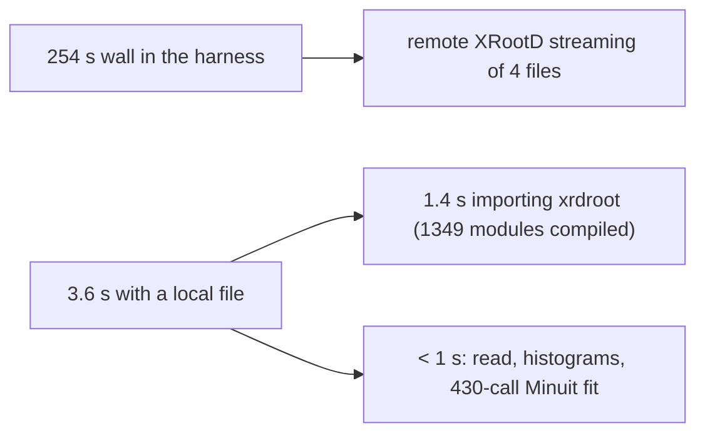

`df101_h1Analysis` is not slow in xrdroot: profiled against a **local** copy of one of its four inputs it finishes in **3.6 s** with 3.6 M calls, and of that **1.4 s is importing xrdroot itself** (`builtins.compile` 1.09 s over 1349 modules, `io.open_code` 0.285 s) while the analysis - reading, histogramming and a 430-call Minuit fit - takes under a second. The 254 s the tutorials harness reports is **remote XRootD I/O**: the script streams four files from `root://eospublic.cern.ch//eos/root-eos/h1/`.

```bash
mkdir -p ~/.cache/xrdroot-runs/h1
PYTHONPATH=$PWD/src python -m xrdroot cp \
  root://eospublic.cern.ch//eos/root-eos/h1/dstarmb.root ~/.cache/xrdroot-runs/h1/dstarmb.root   # 21 MB, ~187 s
# a copy of the tutorial with every Add() pointing at the local file, then
PYTHONPATH=$PWD/src python -m cProfile -s tottime /tmp/df101_local.py
```



## What the numbers say to optimise

| candidate | measured share | worth doing? |
|---|---|---|
| remote I/O | all of the 254 s | no - fix the harness's input, or accept it as network |
| importing xrdroot | **39 % of the local run** (>2 s of a 2.3 s trivial script) | **yes** - the largest single cost a user feels at startup |
| the reader / RDF | under 1 s for 21 MB and four histograms | no |
| the fit | inside that 1 s | no |

Import cost is the one real target, and it is measured, not guessed: a script that does nothing but `import xrdroot.pyroot` pays about two seconds before any physics. `_LAZY`/`LATER` in `src/xrdroot/pyroot/__init__.py` already defers some modules; the profile says the remaining eager `compile` of ~1349 modules is where the time is.
