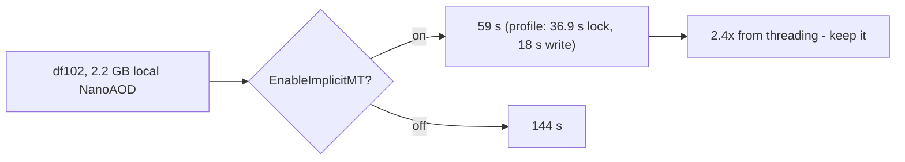

`df102_NanoAODDimuonAnalysis` on a **local** 2.2 GB Run2012BC NanoAOD file takes **59 s** with the tutorial's `EnableImplicitMT()` and **144 s** without it — a real 2.4x from threading, not a lock pathology. Its own hotspots are the 2.2 GB read and the 31 M muon pairs it filters; of the 59 s, 36.9 s shows as `_thread.lock.acquire` and 18 s as `BufferedWriter.write`, which is worker contention that is buying the speedup rather than wasting it.

```bash
# the download: xrdroot cp wrote 510 MB of non-ROOT bytes; ROOT's own TFile::Cp worked
~/.local/root-oracle/bin/root -l -b -q -e 'TFile::Cp("root://eospublic.cern.ch//eos/opendata/cms/derived-data/AOD2NanoAODOutreachTool/Run2012BC_DoubleMuParked_Muons.root","nano.root");'
# 2.24 GB in 173 s
python -m cProfile -s tottime /tmp/df102_local.py          # 59 s, MT on
python /tmp/df102_nomt.py                                  # 144 s, MT off
```



## Two things worth carrying forward

`python -m xrdroot cp` produced **510 MB that was not a ROOT file** (`does not start with b'root'`), while the oracle's `TFile::Cp` fetched the same URL correctly — so remote copies for profiling go through the oracle until our `cp` is fixed against that endpoint.

And the number that matters for planning: **31 104 343 muons filtered to 24 067 843 opposite-charge pairs in 59 s** on one machine, which is the right order for a laptop-sized analysis and says the remaining work in this area is optimising throughput, not fixing a stall.
