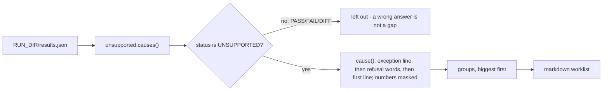

The tutorial harness's 88 `UNSUPPORTED` tutorials are **not** a handful of big families: they are **87 distinct causes**, most of them a single missing name, so "unsupported to zero" means roughly 87 implementations, of which only the GUI/GL/web ones can honestly be scope-labelled. A new `unsupported` subcommand groups a run's refusals so the campaign has a list instead of an impression.

```bash
python -m tools.tutorials unsupported RUN_DIR/results.json
# # 88 refusals in 87 causes
# | 2 | `AttributeError: ROOT has RooLagrangianMorphFunc; xrdroot.pyroot does not yet` | ... |
```



## What the 87 causes are made of

| kind | count | can it reach PASS |
|---|---|---|
| a missing class or function (`ROOT has X; xrdroot.pyroot does not yet`) | ~55 | yes, by implementing it |
| a deliberate refusal of a ROOT 7 or tool class (`RNTupleProcessor`, `RFile`, `RLegend`, `TTaskGroup`, `RNTupleImporter`) | 6 | yes, but each is a subsystem |
| a data-level refusal (`TGeometry`'s streamer, `hprof` merge, RNTuple field shapes) | 5 | yes, by writing that layout or path |
| GUI/GL/web (`TControlBar` ×3, `TSlider` ×2, `TGL*` ×4, `TWebCanvas`) | 10 | **no on a headless mac**: a window or a GL context |
| an external library ROOT was built without (`libEGPythia8`) | 1 | no, for this oracle build |

## How the report picks the reason

A refusal reaches the run as a traceback, so its *first* line is a frame (`File "<frozen runpy>"`), not the reason. `cause()` takes, in order: a line matching `AttributeError:` / `UnsupportedFeatureError:` / `NotImplementedError:`, then a line holding `does not yet` / `missing ROOT` / `not supported` / `cannot translate`, then the first line — masking addresses and numbers so two refusals of one thing group together.
