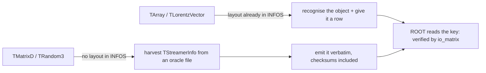

`TMatrixD` cannot be added the way `TArray` and `TLorentzVector` were: `winfo.INFOS` holds **no matrix class at all**, so there is no harvested layout to write from, while those two were already there and only needed recognising. A wrong hand-written `TStreamerInfo` produces files ROOT reads back *wrong* rather than not at all, which is the one outcome this writer refuses.

```python
from xrdroot.winfo import INFOS, ARRAY_LAYOUTS
[n for n in INFOS if "Matrix" in n]        # [] - nothing
[n for n in ARRAY_LAYOUTS if "Matrix" in n]  # [] - nothing
```

## How to get a layout honestly

Harvest it from ROOT itself instead of writing it by hand: write a `TMatrixD` with the oracle, then read that file's `TStreamerInfo` — the same route the existing layouts came from (they carry ROOT's own checksums and versions, which is why they can be emitted verbatim).

```bash
~/.local/root-oracle/bin/python -c "
import ROOT
f = ROOT.TFile.Open('/tmp/m.root', 'RECREATE')
m = ROOT.TMatrixD(2, 2); m.Write('m'); f.Close()
f = ROOT.TFile.Open('/tmp/m.root')
info = f.GetStreamerInfo(); print([ (e.GetName(), e.GetTypeName(), e.GetStreamerType()) for e in info.GetElements() ])
"
```



## What this means for the plan

Group the remaining classes by whether `winfo.INFOS` already describes them. The ones that do are hours (recognise, build a row, check with `tools/io_matrix`); the ones that do not need a harvesting step first, and that step is mechanical but must be done per class rather than guessed.
