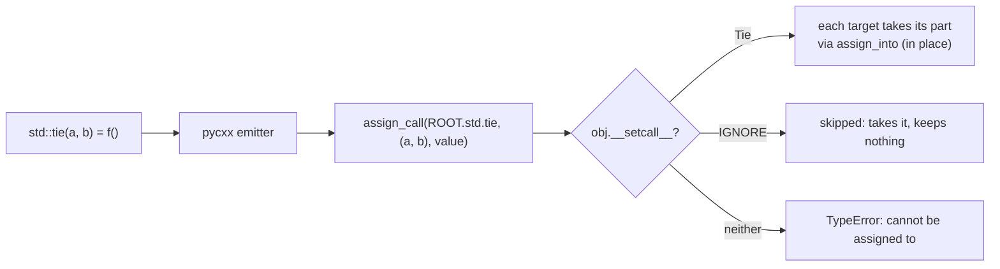

`std::tie(a, b) = f()` **translated correctly and had nothing to run it**: the emitter writes `assign_call(ROOT.std.tie, (a, b), value)`, and the runtime's `assign_call` looked for `__setcall__` on an object that did not exist, so `ROOT.std.tie` was a missing name. The tie target, `std::ignore`, and `it`'s arithmetic from the left are now in `cppstd/references.py` and on `ROOT.std`.



## Why in place, not by name

`std::tie(n, m) = pair` rebinds `n` and `m` in C++. A translated local is a Python **value** (an `int` is 3, not a box holding 3), so a name cannot be rebound from inside a function that was handed the values. What can be changed is the object: `Tie.__setcall__` calls `assign_into(target, part)` for each target, which copies a container's contents into the object it was given — correct for `std::vector`, `std::string` and the classes with `_assign`, and a `TypeError` for anything else. That covers the idiom ROOT's own tests use (`std::tie(a, b) = generate();` with two vectors) and refuses the rest rather than pretending.

A `Tie` with `zip(..., strict=True)` also refuses a count mismatch: `std::tie` names as many targets as the right-hand side must give values, so `names 1 targets and the right-hand side gave 2 values` is a full sentence instead of a silent truncation.

## Two consequences to remember

- A new name in `cppstd/references.py`'s `__all__` must be re-exported from `pycxx/runtime/references.py`, or `tests/test_cppstd_values.py::test_interpreter_reference_exports_keep_the_generic_implementations` fails — that test compares the two lists exactly.
- A vector iterator needs `__radd__`: a translation may write `n + it` where C++ wrote `it + n`, and `int.__add__` returns `NotImplemented` first.

## How to check

```bash
python -c "import xrdroot.pyroot as ROOT; a=ROOT.std.vector['double'](); \
ROOT.std.tie.__setcall__(a, ROOT.std.ignore, (ROOT.std.vector['double']([1.,2.]), ROOT.std.vector['double']())); print(list(a))"
python -c "import xrdroot.cint as c; print(c.translate('void f(){std::vector<double> a; std::vector<double> b; std::tie(a, b) = g();}'))"
python -m tools.rootsuite run --root ~/src/.xrdroot-scratch/rootsrc -j 2 \
  --xrdroot-src <worktree>/src --out ~/.cache/xrdroot-runs/goal-tie --only 'gtest/math/mathcore/testKahan'
```

`testKahan` still fails, now inside a template instantiation (`'int' - '_VectorIterator'`) rather than at `std.tie` — that is its next cause, not a tie one.
