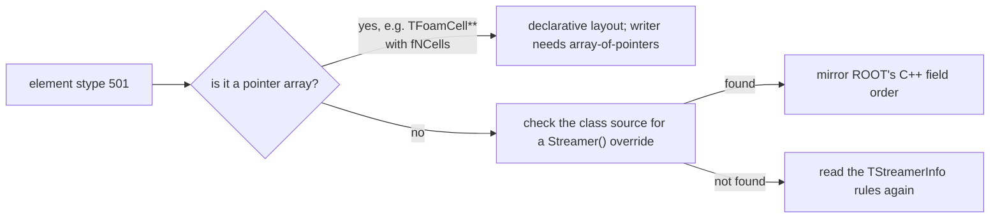

A harvested member with streamer type 501 (`kStreamer`) is **not** proof that the class has a hand-written `Streamer()`: it is also how ROOT describes an **array of pointers**. `TFoam`'s `fCells` is `TFoamCell**` with `fNCells` entries, and `rg "Streamer" math/foam/src/TFoam.cxx` finds no override at all — so the layout is declarative and the writer simply lacks array-of-pointers support.

```bash
cd ~/src/.xrdroot-scratch/rootsrc
git sparse-checkout add math/foam          # 0.6 s, the source was not in the sparse tree
rg -n "Streamer" math/foam/src/TFoam.cxx   # no output: no hand-written streamer
python -c "import json;d=json.load(open('/tmp/foam.json'))['classes']['TFoam'];print([(e['name'],e['stype'],e['type_name']) for e in d['elements'] if e['stype']==501])"
# [('fCells', 501, 'TFoamCell**')]
```



## Why the distinction matters

The two readings imply completely different work. "The class streams itself" means porting C++ by hand, with no layout to harvest. "It is an array of pointers" means the layout is fine and the **writer** needs a loop that, for each of `fNCells` entries, writes a null tag or the referenced object — a bounded feature that also unlocks every other class with a pointer array.

## The check that settles it in one command

Before designing around stype 501, look for `::Streamer` in the class's own source. The sparse clone may not have the module checked out; `git sparse-checkout add math/foam` takes under a second. Absence of an override is decisive, and it changed the plan here from a port to a writer feature.
