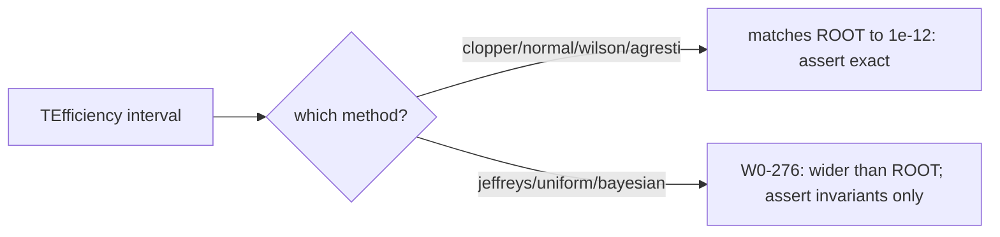

`xrdroot.efficiency`'s Clopper-Pearson, normal, Wilson and Agresti-Coull intervals match ROOT 6.40.04's `TEfficiency` to twelve digits, but its three **Bayesian** methods (Jeffreys, uniform, bayesian) do not — ours answers a wider interval at the default level. Queued as `W0-276`; a test must not pin those numbers until it is closed.

## How the four matching methods were confirmed

The oracle can build a `TEfficiency` from two histograms with no file at all, which is how the numbers were read:

```python
# ~/.local/root-oracle/bin/python
p, t = ROOT.TH1D("p", "", 4, 0, 4), ROOT.TH1D("t", "", 4, 0, 4)
for i, (a, b) in enumerate(((3, 10), (0, 5), (5, 5), (1, 2)), 1):
    p.SetBinContent(i, a); t.SetBinContent(i, b)
e = ROOT.TEfficiency(p, t)
e.SetStatisticOption(0)                       # 0 clopper-pearson, 1 normal, 2 wilson, 3 agresti-coull
e.GetEfficiency(1), e.GetEfficiencyErrorLow(1), e.GetEfficiencyErrorUp(1)
```

**ROOT quotes the distance from the efficiency, not the bound.** `GetEfficiencyErrorLow` for 3/10 is 0.158328098893, so the *lower bound* is `0.3 - 0.158328098893 = 0.141671901107` — which is exactly what `Efficiency.intervals()` returns. Comparing the oracle's errors to our bounds directly makes every method look wrong.

## The divergence, measured

At the default level (0.682689492137086), bin 1 (3 of 10):

| method | ROOT errors (low, up) | our bounds (low, high) |
|---|---|---|
| jeffreys | 0.13824955824, 0.139568808873 → bounds 0.16175, 0.43957 | 0.179932259942, 0.457750627054 |
| uniform / bayesian | 0.134458930399, 0.135466298119 | wider, likewise |

Also worth knowing: for a bin where everything passed, ROOT **swaps** the pair — 5/5 gives `ErrorLow` 0.308024 and `ErrorUp` 0.0, i.e. a zero "up" is ROOT's way of saying the efficiency is 1 and only the lower bound is real.



## For a test of an efficiency

Book two histograms, build with `Efficiency.from_histograms(passed, total, name)`, then `fill(passed_flags, x)` (or `weight=` for `FillWeighted`, which sets the `USE_WEIGHTS` bit). `values()`, `intervals(method=…)` and `to_numpy(flow=…)` are the readers. Assert exact numbers only against the oracle; a bin where nothing or everything passed can sit outside a posterior's bounds, so restrict "the efficiency is inside its interval" to bins that are neither.
