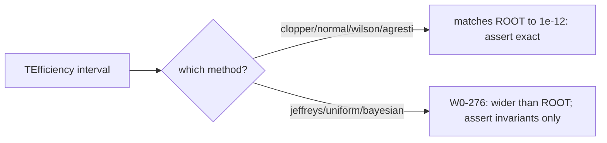

`xrdroot.efficiency`'s Clopper-Pearson, normal, Wilson and Agresti-Coull intervals match ROOT 6.40.04's `TEfficiency` to twelve digits, and its three **Bayesian** methods match ROOT's own `BetaCentralInterval` exactly — the numbers `TEfficiency`'s *object* reports differ because they take the shortest interval, which `xrdroot` refuses in a sentence rather than guessing. Queued as `W0-276`.

## How the four matching methods were confirmed

The oracle can build a `TEfficiency` from two histograms with no file at all, which is how the numbers were read:

```python
# ~/.local/root-oracle/bin/python
p, t = ROOT.TH1D("p", "", 4, 0, 4), ROOT.TH1D("t", "", 4, 0, 4)
for i, (a, b) in enumerate(((3, 10), (0, 5), (5, 5), (1, 2)), 1):
    p.SetBinContent(i, a); t.SetBinContent(i, b)
e = ROOT.TEfficiency(p, t)
e.SetStatisticOption(0)                       # 0 clopper-pearson, 1 normal, 2 wilson, 3 agresti-coull
e.GetEfficiency(1), e.GetEfficiencyErrorLow(1), e.GetEfficiencyErrorUp(1)
```

**ROOT quotes the distance from the efficiency, not the bound.** `GetEfficiencyErrorLow` for 3/10 is 0.158328098893, so the *lower bound* is `0.3 - 0.158328098893 = 0.141671901107` — which is exactly what `Efficiency.intervals()` returns. Comparing the oracle's errors to our bounds directly makes every method look wrong.

## The divergence, measured — and what it really is

At the default level (0.682689492137086), bin 1 (3 of 10):

| method | `TEfficiency` object's errors (low, up) | our bounds |
|---|---|---|
| jeffreys | 0.13824955824, 0.139568808873 → bounds 0.161750, 0.439569 | 0.179932259942, 0.457750627054 |
| uniform / bayesian | 0.134458930399, 0.135466298119 → bounds 0.165541, 0.435466 | 0.198874402935, 0.468799631453 |

**That is not our arithmetic being wrong.** ROOT's own central-interval functions give *our* numbers:

```python
# ~/.local/root-oracle/bin/python, ROOT 6.40.04
ROOT.TEfficiency.Bayesian(10, 3, L, 0.5, 0.5, False, False)     # 0.17993225994167145
ROOT.TEfficiency.BetaCentralInterval(L, 3.5, 7.5, False)         # 0.17993225994167145
ROOT.Math.beta_quantile((1 - L) / 2, 3.5, 7.5)                   # 0.17993225994167145
```

All three are the textbook Jeffreys interval `Beta(3.5, 7.5)` at one sigma, which is what
`Efficiency.intervals()` returns to twelve digits. So the object path of `TEfficiency` passes something
else than (alpha = beta = 0.5, that level, central) - `TestBit(kShortestInterval)` sends it to
`BetaShortestInterval`, and its answer for a right-skewed posterior is **shifted**, not simply narrower.

**Where `xrdroot` stands**: it computes the central interval correctly and **refuses** the shortest one
with a full sentence - *"'eff' asks for the shortest Bayesian interval rather than the central one,
which this reader does not work out"*. `W0-276` is therefore "implement `BetaShortestInterval`", not
"fix our quantiles".



## For a test of an efficiency

Book two histograms, build with `Efficiency.from_histograms(passed, total, name)`, then `fill(passed_flags, x)` (or `weight=` for `FillWeighted`, which sets the `USE_WEIGHTS` bit). `values()`, `intervals(method=…)` and `to_numpy(flow=…)` are the readers. Assert exact numbers only against the oracle; a bin where nothing or everything passed can sit outside a posterior's bounds, so restrict "the efficiency is inside its interval" to bins that are neither.
