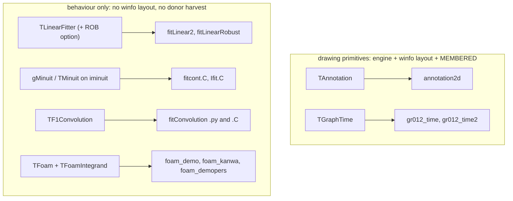

The five classes behind the tutorials' refusals (`TAnnotation`, `TGraphTime`, `TLinearFitter`, `TF1Convolution`, `TFoam`) are not implemented in any form, and neither are `gMinuit`, `TGenPhaseSpace` or `TFoamIntegrand` — so the work is five from-scratch implementations rather than a fix, and it is worth knowing that before planning a batch of "small fixes".

```bash
cd <worktree> && rg -ln "class TAnnotation|class TGraphTime|class TLinearFitter|class TF1Convolution|class TFoam\b|TGenPhaseSpace" src/xrdroot   # no output
rg -n "TAnnotation|TGraphTime|TLinearFitter|TF1Convolution|TFoam" src/xrdroot/winfo.py                                                    # no output
```



## What each one costs, cheapest first

| class | shape of the work | tutorials |
|---|---|---|
| `TAnnotation` | engine class + harvested `winfo` layout + `writer.MEMBERED` + `tools/io_matrix` proof, per `docs/instructions/a-drawing-primitive-crosses-in-three-mechanical-steps.md` | 1 |
| `TGraphTime` | graph-like store of snapshots drawn frame by frame; same pipeline | 2 |
| `TLinearFitter` | wrapper over the existing `fit/` engine, plus the `ROB` robust option refused today | 2 |
| `gMinuit` | the `TMinuit` adapter on iminuit, already a listed known item | 2 |
| `TF1Convolution` | convolution of two `TF1`s inside `formula/`, then an `TF1` built from it | 2 |
| `TFoam` | adaptive sampler plus the `TFoamIntegrand` protocol; by far the largest | 3 |

Only the two drawing primitives need a `winfo` layout (and a donor harvest); the other four are behaviour, not persistence.

## Before starting any of them

Plan one commit per class, gated individually — and get the full `pytest -n 5 --cov=xrdroot` gate to complete at least once on the machine first. It timed out three times on a loaded box (2900 s, 600 s, 1699 s) while the tutorial tool tests alone ran in 21 s, so check the machine before reading such a timeout as a failure of new code.
