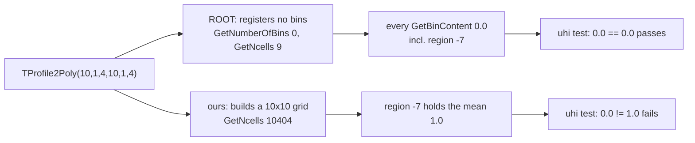

`pyunittest/bindings/pyroot/pythonizations/uhi_indexing` fails on `TProfile2Poly` only, and the cause is not the UHI indexing: our `TProfile2Poly(name, title, nx, xlo, xhi, ny, ylo, yhi)` builds a grid of bins while ROOT's builds **none**. The oracle says so directly — `GetNumberOfBins()` is 0 and `GetNcells()` is 9 after `TProfile2Poly("t","t",10,1,4,10,1,4)` plus 10 000 fills, and every read is 0.0, including regions. Fixing the test means making that constructor register no bins, which reaches every test built on it; a narrower patch to `GetBinContent` fixes the test and breaks two of our own that pin the region mean, so it was reverted.

## Ask the oracle with one command

The ROOT 6.40 install is the fastest way to settle a semantic question:

```bash
~/.local/root-oracle/bin/python3 -c "
import ROOT
h = ROOT.TProfile2Poly('t','t',10,1,4,10,1,4)
for i in range(10000): h.Fill(ROOT.gRandom.Uniform(0,5), ROOT.gRandom.Uniform(0,5), 1.0)
print(h.FindBin(1,1), h.GetBinContent(-7), h.GetBinContent(1), h.GetNumberOfBins(), h.GetNcells())"
# -7 0.0 0.0 0 9
```

Ours answers `-7 1.0 0.0 0 10404`: `FindBin` agrees, so the search is right, and the difference is entirely that we keep cells and a region mean where ROOT keeps neither.



## Two traps found on the way

- PyROOT cannot call `AddBin(Double_t x1, y1, x2, y2)` — it resolves to `AddBin(TObject*)` and raises `TypeError: argument 1 must be cppyy.CPPInstance, not float`. Measure `AddBin` behaviour on ROOT only through `AddBin(Int_t n, const Double_t *x, const Double_t *y)` or not at all.
- ROOT's `TProfile2Poly::Fill` *does* fill `fOverflowBins` (source, `TProfile2Poly.cxx:178`), yet the constructor-built profile still reads 0: with no bins registered, the fill path and the reads never meet. Source-level reasoning alone gets this wrong; the oracle's answer is the one to trust.

## What a correct fix looks like

Make the constructor build an empty poly (ROOT's `GetNcells() == 9`, `GetNumberOfBins() == 0`) and let `AddBin` create the bins, then re-run the four `uhi_*` pyunittest files, `tests/test_pyroot_th2poly_bin_error.py`, `tests/test_pyroot_profile_fill_loop.py` and the `TProfile2Poly` plotting tests. Expect those that assume the constructor's grid to need rewriting to ROOT's behaviour — that is the real work, not a one-line guard.
