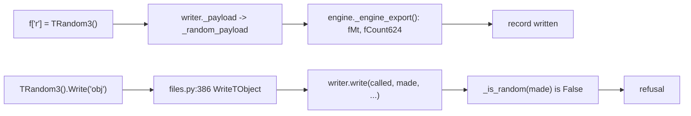

The random engines already export their state for a writer to use — `src/xrdroot/random/mersenne.py:77` has `_engine_export()` returning `{"fMt": 624 uint32, "fCount624": int}` and `_engine_import(state)` to load it back — so `TRandom3` needs no new accessor. What it needs is a decision about *which write route* is being tested: `f[name] = obj` accepts it today, while `obj.Write("obj")` refuses.

```python
import xrdroot, xrdroot.pyroot as ROOT
with xrdroot.create("r.root") as f:
    f["r"] = ROOT.TRandom3()          # works, default seed included
# but:
f = ROOT.TFile.Open("r2.root", "RECREATE")
ROOT.TRandom3().Write("obj")          # UnsupportedFeatureError
```

## Why the two routes differ

`src/xrdroot/pyroot/core/files.py:386` (`WriteTObject`) calls `writer.write(called, made, title=obj.GetTitle())` — the object the writer receives there is not the one whose engine `_is_random` inspects, so the shaped payload is never reached. Until that is traced, `tools/io_matrix.py` will keep reporting `FAIL` on the write column even though the layout is right, because its child uses the second route.



## Two facts the layout needs

1. A fixed-array element carries its length in the declared slot: `('TStreamerBasicType', 'fMt', '', 33, 4, 624, 0, (624, 0, 0, 0, 0), 'unsigned int', ())` — without the `624`, `_number_element` raises *"fMt holds 624 values where 0 were declared"*.
2. `TRandom3` is three classes: itself (v2, 2185949371), `TRandom` (v3, 235880363, with `TNamed` and `ROOT::Math::TRandomEngine` bases) and `ROOT::Math::TRandomEngine` (v1).
