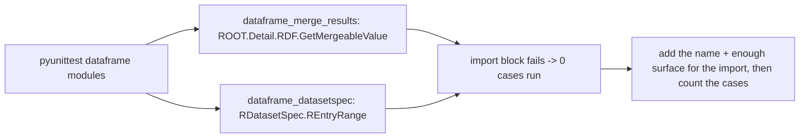

Two of the three dataframe/ntuple failures in the pyunittest kind stop at *collection*, before a single test runs, and each names one missing Python-visible class: `ROOT.Detail.RDF.GetMergeableValue` for `dataframe_merge_results.py` and `ROOT.RDF.Experimental.RDatasetSpec.REntryRange` for `dataframe_datasetspec.py`. Both are raised by the project's own deliberate refusals, so the failure text names the work precisely.

```text
dataframe_datasetspec.py:8: REntryRange = ROOT.RDF.Experimental.RDatasetSpec.REntryRange
E   AttributeError: type object 'RDatasetSpec' has no attribute 'REntryRange'

dataframe_merge_results.py:  ROOT.Detail.RDF.GetMergeableValue
E   AttributeError: ROOT has Detail.RDF.GetMergeableValue; xrdroot.pyroot does not yet
   (raised at src/xrdroot/pyroot/core/rangecast.py:171)
```

## Why it matters

A collection failure hides the rest of the module: you cannot count how many cases sit behind it until the import succeeds. Both names are the *entry point* of an API surface (`GetMergeableValue` + `MergeValues` for cross-process result merging; `RDatasetSpec`'s range and sample types for the dataset-spec builder), so the first one to add must be accompanied by enough of the surface for the module's import block to complete.



## What to do

Add the name so the module imports, re-run it, and only then look at the cases - the count is unknown until collection passes. Do not guess from the module's title: `dataframe_merge_results` needs the merge-value API, not the merge of frames.
