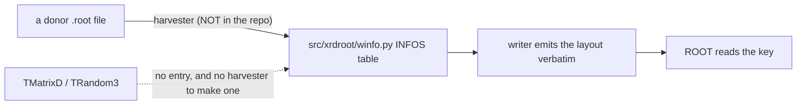

`src/xrdroot/winfo.py` is generated knowledge — "harvested rather than typed" from donor ROOT files — but **no harvester is in the repository**: `rg -ln "StreamerInfo"` finds only `tools/rootsuite/baseline.json`, and there is no script that reads a donor file and emits the `INFOS` table. So adding a class whose layout is absent (`TMatrixD`, `TRandom3`) needs that step written before the class can be added at all.

## What the file says about itself

```text
src/xrdroot/winfo.py:1   """What the classes this library writes look like, harvested rather than typed.
src/xrdroot/winfo.py:8   ...donor happens to contain...
src/xrdroot/winfo.py:24  donors: TF1, TFormula and TF1Parameters from tgme.root...
src/xrdroot/winfo.py:52  ...its checksum is what ... reproduces every harvested checksum in...
```

`tests/data/*.root` are the donor files that exist (chain, flat chain, …), and `winfo.py:54` claims a checksum calculation that reproduces every harvested value — i.e. a class could in principle be added from its element list alone, with the checksum computed here.



## What to do

1. Write the harvester (`tools/harvest_infos.py`): open a donor file with the oracle, walk each `TStreamerInfo` — name, checksum, class version, and per element the kind, name, title, stype, sizes, max-index tuple and type name — and emit the tuple `winfo` wants.
2. Run it on an oracle-written `TMatrixD`/`TRandom3` file and paste the result into `winfo.py` (or keep the donor under `tests/data/` and generate at build time).
3. Check the result with `python -m tools.io_matrix --classes TMatrixD,TRandom3` — PASS in both directions is the acceptance.

Do not hand-type a layout: `winfo.py:54` says the checksum is *derived*, so a guessed one writes a file ROOT reads back wrong rather than not at all.
