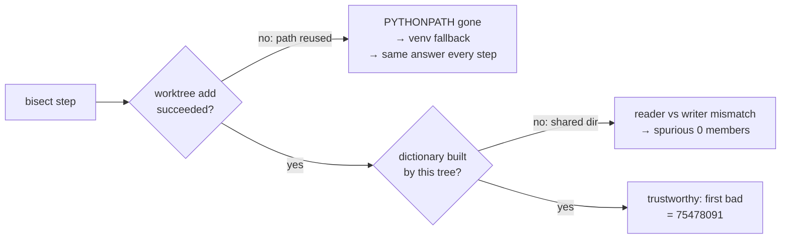

Two of the three unexplained harness failures are now understood without being fixed, and both lessons are about how the measurement was wrong rather than about the code. `test_hadd_regr_20872` is not a bug at all: its command is `hadd -f merged_20872.root root://eospublic.cern.ch//eos/root-eos/h1/dstarmb.root`, guarded by `if(xrootd AND NOT MSVC)`, so it needs CERN's network and times out for want of a route. `CheckMissingDictionaries` is a real regression, bisected to commit `75478091`, and the bisect only became trustworthy once each commit built its own dictionary.

## A shared work directory makes a bisect lie

The first bisect pointed at the wrong commits twice. It reused one worktree path, so `git worktree add` failed, the directory was gone, and python fell back to the installed package — every step then reported the *same* tree. The second used one harness work directory whose `libIOWithoutDictionaries_dictrflx.xrdlib` had been built by a different commit than the reader.

The measurement that holds runs the harness per commit, so the dictionary is built by the same tree that reads it:

```bash
for c in $(git rev-list --reverse GOOD..BAD); do
  d=/scratch/wb-$c; git worktree prune; git worktree add -q --detach $d $c
  (cd $d && PYTHONPATH=$d/src python -m tools.rootsuite run --root $ROOTSRC --jobs 1 \
      --only 'roottest/root/io/withoutDictionaries/*' --xrdroot-src $d/src --out /scratch/o-$c)
  jq -r '.tests[] | select(.id|endswith("CheckMissingDictionaries")) | .status' /scratch/o-$c/results.json
  rm -rf $d /scratch/o-$c
done
```

Two things to keep: assert `xrdroot.__file__.startswith(os.environ["PYTHONPATH"])` in any probe, or a missing directory silently becomes "the installed package"; and pass the **whole** glob, never the test alone, because its fixture is what creates the class the test reads.



## What the regression is not

`75478091` bundled three changes: the writer applying each patch once, the directory `Write` checkpointing only at the outermost level, and reflection's namespace index replacing a scan of `sys.modules`. Reverting the writer half did not fix the test, and neither did making the namespace index rescan on a miss or key it on the declared-class count — so the culprit is still unidentified inside that commit. Nothing was committed for this: a change that does not fix the thing it claims to is worse than an open bug.
