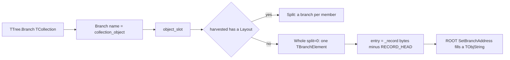

`harvested()` in `src/xrdroot/wclasses.py` only accepts elements that are `TStreamerBasicType` or `TStreamerObjectAny`, so no class with a `TStreamerBase` and no class with a `TStreamerString` member gets a `Layout` — `harvested("TObjString")` is `None` while `harvested("TAttLine")` is a layout. Anything that reaches `object_slot` with such a class therefore has two choices: refuse it by name, or write it whole.

For a branch of such a class, write it whole. `pyroot/trees/objects.py`'s `Named` kind does that for `TObjString`: `Whole(classname, split=0)` is a `TBranchElement` whose entry is `_record(...)[RECORD_HEAD:]`, the members the class's description names without the byte count and version its streamer puts round them. ROOT writes the same thing when `splitlevel` is 0, and — measured on the 6.40 oracle — it reads ours back with `SetBranchAddress`/`GetEntry` filling a `TObjString` that answers its name. What differs from ROOT's own `splitlevel=99` is only that ROOT splits the object into `fUniqueID`, `fBits` and `fString` sub-branches and we do not.

## What the split would need

Flattening `TStreamerBase` into the base's members and allowing `TStreamerString` in `SPLITTABLE`, a string column in `Split._member` the way `Collection._member` already makes one with `StringRows`, and a read-back of a `TString` leaf into the object. That is a change to every class `harvested` describes, so it belongs in its own round with the tree area measured either side — not in a round that needed one bool.

## How to read one back as an object

A row read out of a whole branch is a dict (`{'TObject': {...}, 'fString': 'one'}`), and `row_object` turns it into the object only for a class `BY_ROW` names or one the program declared. Add the class there rather than making every caller know a dict is not the object ROOT hands back.
