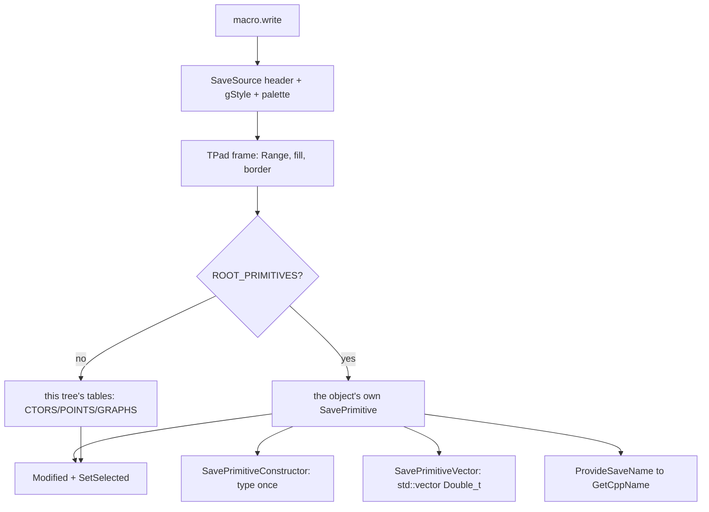

A canvas saved under a `.C` name is written the way ROOT writes it — `TCanvas::SaveSource`'s header and style lines, `TPad::SavePrimitive`'s range/fill/border, then each object's *own* `SavePrimitive` — and not from one template over the pad's members. Sizes are part of the contract: ROOT's own `testMapCppName` asserts the file is 6644±200 bytes, so a macro that rebuilds the same picture in a different shape (this tree's old ten `SetPoint` calls a graph, `th1f2` for a histogram variable) fails even though it runs.

## The pieces

- `pyroot/graphics/macro.py::write` — the frame: `#ifdef __CLING__`, `#pragma cling optimize(0)`, `#endif`, `void <file stem>()` unless the stem starts with a digit, the `//=========Macro generated from canvas:` comment, `TCanvas *<canvas name> = new TCanvas(...)`, `gStyle->SetOptFit/SetOptStat/SetOptTitle`, `TColor::SetPalette(57, nullptr)`, `Range`, fill and border, the primitives, then `<canvas>->Modified(); <canvas>->SetSelected(<canvas>);`.
- `ROOT_PRIMITIVES` names the classes that write ROOT's text themselves — every `TH1`/`TH2`/`TH3` kind, `TProfile`, `TH2Poly`, `TGraph`. The rest fall back to this tree's own `CTORS`/`POINTS`/`PIECES`/`GRAPHS`/`HOLDS` tables and are *not* ROOT's macro.
- `TObject::SavePrimitiveConstructor` — the type is spelled out once per macro (`gROOT->ClassSaved`), so a macro's second `TGraph` is `graph = new TGraph(...)`.
- `TObject::SavePrimitiveVector` — a graph's points are `std::vector<Double_t> graph_x_vectN{ … }` (ten to a line past fifteen, 16 significant digits) and the constructor gets `name.data()`.
- `TH1::ProvideSaveName` → `_identifier` → `ROOT::TMetaUtils::GetCppName`: ROOT writes `lEoBsPnOaTdApEaNhAmUoPcPdOcOoBcBdIpLeQmIaNcLoRsQwAcBgR__N` for `<[ !@$%&^*().,[]/+=-&:|'~]>`, not an underscore a character.

## Where it breaks

- A canvas named `graph`, `hist` or `pad` collides with the fixed names ROOT gives primitives (`TGraph`'s variable is always `graph`), so ROOT's own macro would not compile. Name a test canvas something else.
- A graph drawn with no option is `"alp"` in ROOT (`hist/hist/src/TGraph.cxx:880`, when the pad has no `TFrame`) and `""` here, so the macro says `Draw()` — `W0-212`.
- `TGraphErrors`/`TGraphAsymmErrors`/`TGraphBentErrors` and `TProfile2D`/`TProfile3D` have no `SavePrimitive` here and are refused by name — `W0-214`.

## How it was measured

`gtest/hist/hist/testMapCppName` went FAIL→PASS in round 93: ROOT's file is 6616 bytes/93 lines, this tree's 6598/93, and the macro runs under `xrdroot run` (exit 0, all five objects rebuilt). The oracle's file for such a canvas is regenerated by copying the test body into a `void name()` macro and running `~/.local/root-oracle/bin/root -l -b -q`.
