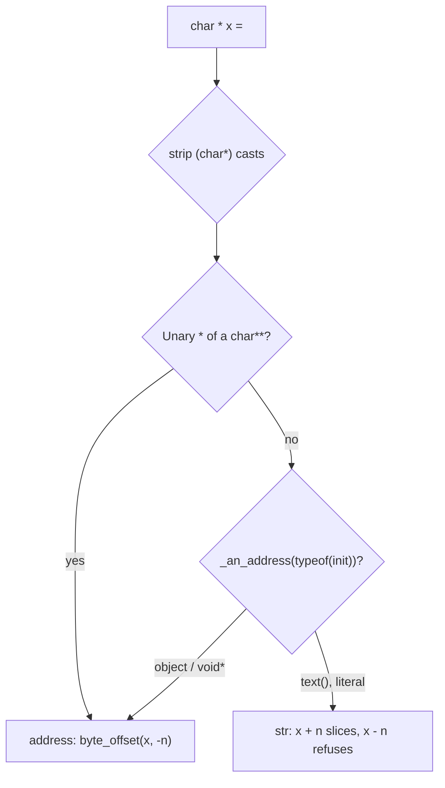

A `char *` in translated C++ may hold an object's address or text, and the only thing that decides which is its **initialiser** — the mark has to live on the symbol, because the type is identical in both cases.

## Why the type cannot answer

ROOT's `roottest/root/io/datamodelevolution/common/Dumper.h` keeps an address in a `char *` and steps it back:

```cpp
char *ele = *(char **)proxy->At(i);
ele -= actClass->GetBaseClassOffset( vcl );   // Dumper.h:97
```

`Dumper.h`'s generator does the same forward: `char *ptr = ((char *)obj) + member->GetOffset();`.

Requiring a `char *` minus an integer to be `byte_offset(x, -n)` makes both work — and breaks two honest refusals, which two unit tests in `tests/test_cint_expressions.py` pin:

```cpp
char *p = text(); p = p - 1;          // a str has nothing behind it
char *c = ((char *)d) - 8;            // likewise
```

Both are `char *`. Nothing in the type says which is which, so the refusal was right and the fix could not be "allow it".

## The shape that works

The mark goes on the **symbol**, taken from the initialiser when the local is declared, and the pointer arithmetic asks it:

| file | piece |
|---|---|
| `pycxx/symbols.py` | `Symbol.address: bool` — "this `char *` holds an object's address" |
| `pycxx/emit_vars.py` | `_holds_an_address(decl, ctype, addressing)` at the local's declaration |
| `pycxx/emit_expr.py` | `ExprEmitter.addressing(init)` — is this initialiser an address? |
| `pycxx/emit_expr.py` | `_holding_an_address(expr)` in `_text_offset`, which decides bytes vs characters vs refusal |

Two initialiser shapes are addresses, and both were measured before they were believed:

- `(char *)obj` of an object, a member's pointer, or a `void *` — `_an_address(typeof(init))`;
- `*(char **)cell`, a pointer read out of a cell — which is how ROOT's own walkers hand an object over.



## The trap in `*(char **)cell`

`typeof(init.operand)` answers the type **that went into** the cast, not the cast's own. So `*(char **)it` reads as `TIter *` and the cell is missed; the cast's `ctype` is what says `char **`. `emit_expr._cast_type(node)` is that reading, and without it the whole shape silently stayed refused.

A second trap: the `+` branch ("the C string from there on") is checked **before** the address branch in `_offset`, so `ele += n` on an address would slice an `ObjectBytes` — the address test has to come first.

## How to check it

```bash
export PYTHONPATH=$PWD/src
.venv/bin/python -c "from xrdroot.pycint import translate; print(translate('void f(void *o){char *e=(char *)o; e-=8;}','t.C'))"
# -> byte_offset(e, -(8))
.venv/bin/python -m pytest -q tests/test_cint_expressions.py -k only_a_char_pointer
```

The harness proof is `roottest/root/io/datamodelevolution/*`: `Dumper.h:97` passes and the family's wall moves to `:337`.
