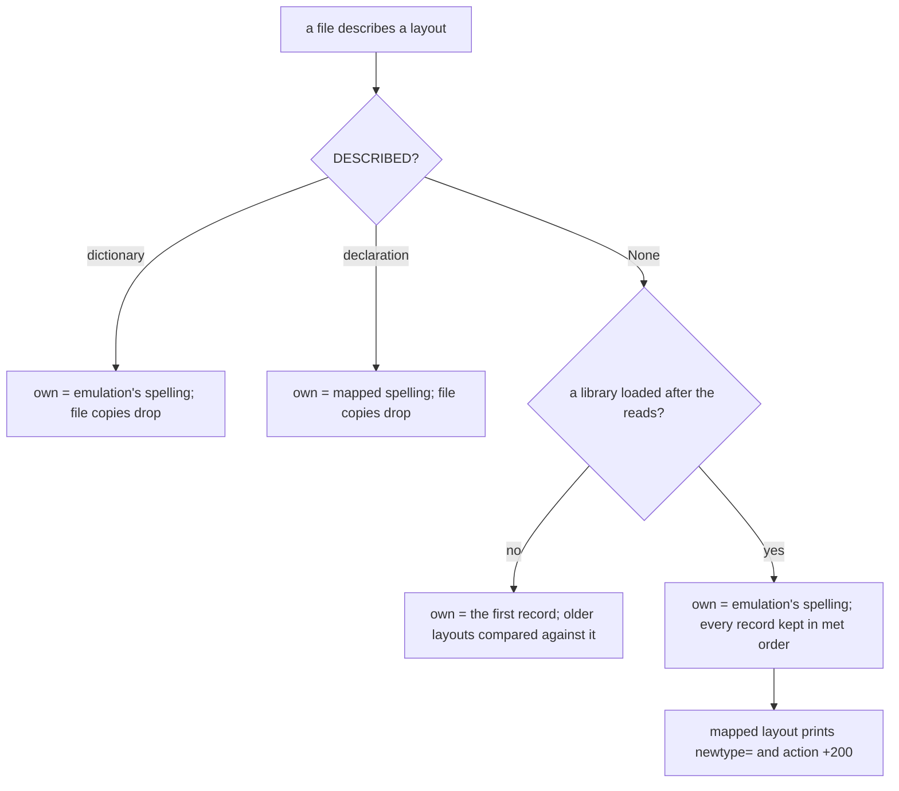

Which layout a class owns — and so which layout a file's record is compared against, and how many blocks its listing has — depends on **when** the session learned the class relative to reading the file and loading a library. There are three answers: a library loaded *before* the reads, an `#include` before them, and a library loaded *after* them.

## The three answers

| when the session learned the class | the class's own layout | a file's copy of that spelling |
|---|---|---|
| a **library** whose LinkDef reached a member's type, loaded **before** the reads | the **emulation's** spelling (`R__CreateEmulatedElement`'s, `first type=13`, title `Emulation`) | the same layout — dropped when met |
| an **`#include`**, no dictionary | the file's **mapped** spelling (`first type= 3 newtype=13`, action `203`) | the same layout — dropped when met |
| **nothing**, then a library loaded **after** the reads | the **emulation's** spelling, gained by the re-emulation | **kept**, at every slot a file met it at |

The third row is the one that costs a round if it is missed: `io/stdpair`'s `0_*_1_0`/`1_*_1_0`
families then list **four** blocks — the emulation as current, the mapped layout, then the emulation
twice — where `0_*_1_1` lists three, and only the file order tells them apart.

## What decides it, in ROOT's terms

`TClass::Update` re-emulates a class through its collection proxy once the types its members hold
have a dictionary, and a class nothing described gains the layout `R__CreateEmulatedElement` makes.
`TStreamerInfo::BuildCheck`'s checksum rule then keeps the file's earlier records where they were
met. A library loaded *before* the reads is different in kind: ROOT registers the emulation **first**,
so the file's record of the same spelling is that layout and is dropped.

In this kit the three answers are `DESCRIBED` (`"dictionary"` / `"declaration"` / `None`) plus
`_reemulated()` — nothing described the class *and* it is in `RELOADED` — inside
`src/xrdroot/pyroot/core/reflection.py`.

The guard that makes this cheap to check: `io/stdpair` is 36 of 44 at this writing, and the eight
`3_*` families left need the pair's **own** dictionary, a different question.
