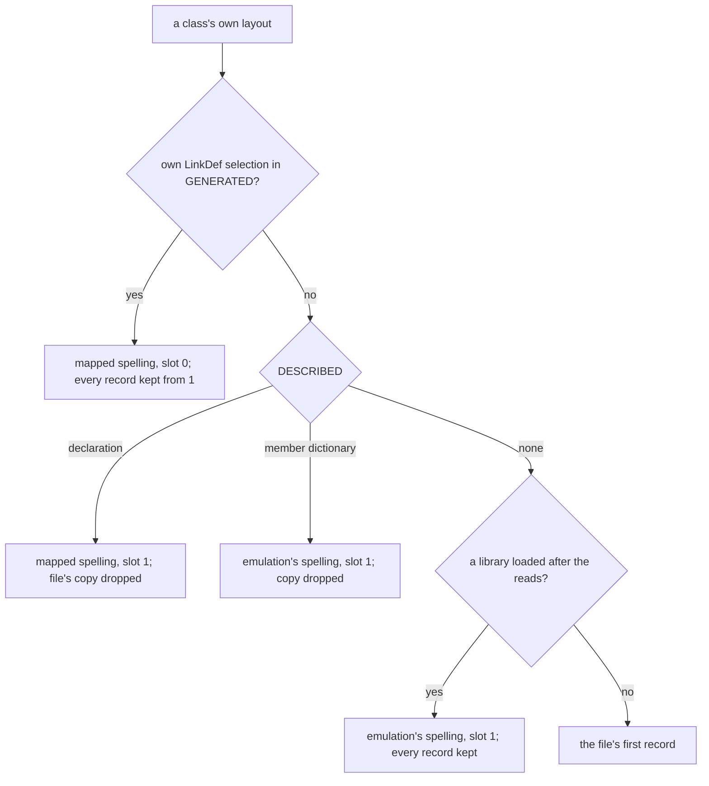

The three-answer table of round 121 (a library before the reads, an `#include`, a library after them) has a **fourth** state: a library whose LinkDef selects the **class itself**. There ROOT lays the class out from that compiled dictionary — the file's *mapped* spelling — files it at slot **0** of `fStreamerInfo`, and keeps every record a file holds from slot 1 on. `io/stdpair`'s eight `3_*` families are that state, and they were the last eight failures of the bucket.

## What the four states print

`pairEnumEvo`'s macro prints the current layout, then every slot from 1 to `GetSize()-2` that is not the current one:

| state | the class's own layout | where | a file's records |
|---|---|---|---|
| a **member's** dictionary, loaded before the reads | the **emulation's** spelling | slot 1 | a copy of it is that layout — dropped |
| an **`#include`** | the file's **mapped** spelling | slot 1 | a copy of it is that layout — dropped |
| **nothing**, then a library after the reads | the **emulation's**, from the re-emulation | slot 1 | **all kept**, in the order met |
| a **dictionary of the class itself** | the file's **mapped** spelling, from the dictionary | **slot 0** | **all kept**, from slot 1 |

The fourth row is why `3_0_0_1` prints `#1` (the emulation) and `#2` (the mapped record) beside a
current layout the walk never reaches, and why that current layout carries `newtype=13` and action
`203` — it is set against the emulation ROOT built beside it.

## The tell, and the code

`GENERATED` holds the names a **loaded library's** LinkDef selected, so asking it for the class's
own bare name answers "this class has a dictionary of its own" — `_dictionaried(name)` in
`src/xrdroot/pyroot/core/reflection.py`, wired through `_own_dictionary()`, `_own_is_mapped()` and
`_keeps_records()`. A class with its own dictionary outranks a re-emulation: `3_*_1_*` reads its
files first and loads afterwards, so both states hold, and the dictionary still wins.

`io/stdpair` is 44 of 44 at this writing, and the guard areas that share this code
(`io/tree`, `io/emulated`, `meta/evolution`, `io/datamodelevolution`, `io/newstl`) are unchanged at
83 / 39 / 13 / 6 of 141.
