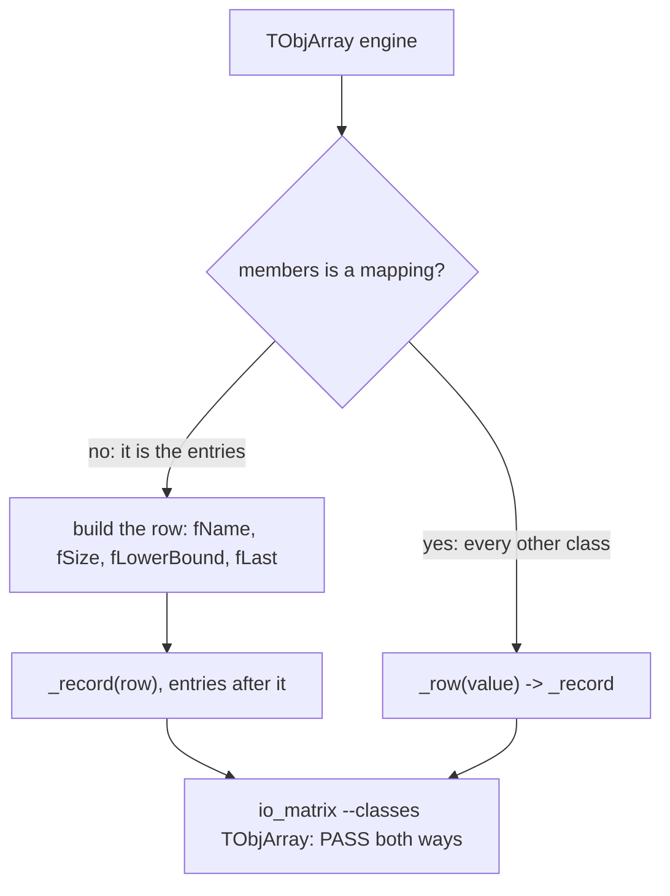

`TObjArray` is the one class in the eighteen-class sample whose `members` is a **sequence**, not a mapping: `unwrap(ROOT.TObjArray()).members` is its list of entries, so the generic route — build a row from `members`, hand it to `_record` — packs a list where a member dict is required and refuses with `a TObjArray here is a list rather than the dict of members writing one starts from`.

```python
from xrdroot.pyroot.core.records import unwrap
import xrdroot.pyroot as ROOT
engine = unwrap(ROOT.TObjArray())
type(engine).__name__     # 'TObjArray'
engine.members            # its ENTRIES - a list, not a dict of fields
```

## What a collection payload must therefore do

1. **Build the row itself** — the collection's own members are `fName` (from `TCollection`), `fSize`, `fLowerBound` and `fLast` — and never go through the `members`-based normaliser.
2. **Bypass `_row()`**, which is the function that returns `value.members`: for this class the row is constructed, not read.
3. Then write the entries, because a sequence's count in `fSize` has to agree with what follows it in the record.



## Why this is the last one and not the first

The other seventeen payloads (arrays, vectors, matrices, engines, colours, graphs, text) all normalise a member dict; adding `_is_collection` plus a payload that still let `_record` read `members` reproduced the same refusal. The distinguishing question for any new class is therefore: **is `members` a mapping of fields, or the object's contents?** `TList`/`THashList` already answer "contents" and go through `_list()`; `TObjArray` needs the same treatment with its own header.
