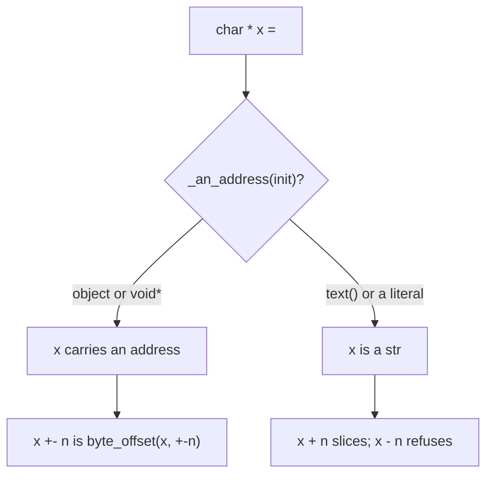

A conflicted file committed to trunk is invisible to every gate except the build, so grep the shipped files for conflict markers after any amend or rebase. Separately: `char * - n` cannot be modelled on Python's `str`, and the distinction C++ makes is provenance, not type.

## Conflict markers survive every gate

`TODO.md` at `2ba1f008` carried a whole conflicted block — `<<<<<<< HEAD`, a ledger row, `=======`, the same row again, `>>>>>>>` — left by an amend that a later rebase could not replay. It passed CI, `ruff`, `mypy`, `maintainability`, `components` and `mkdocs --strict`, because **nothing reads `TODO.md`**: pytest does not import it, and mkdocs' `strict` only checks pages the nav names.

What does catch it:

```bash
git show HEAD:<file> | grep -nE '^(<<<<<<<|=======|>>>>>>>)'   # committed form
grep -rn '^<<<<<<<' --include='*.md' --include='*.py' .          # the whole tree
git diff --stat                                                  # before every commit (W0-115)
```

`git diff --stat` alone is not enough after an amend: the markers were **committed**, so a clean working tree says nothing. Check the *committed* content of any file an amend touched.

## `char * - n` is provenance, not type

`roottest`'s `Dumper.h` keeps an address in a `char *` and steps it back:

```cpp
char *ele = *(char**)proxy->At(i);
ele -= actClass->GetBaseClassOffset(vcl);
dump(ele, actClass, out, prefix);
```

Emitting `byte_offset(ele, -(n))` for every `char *` minus an integer makes that work and makes the whole `datamodelevolution` generator finish — but two unit tests pin the refusal for `char *p = text(); p = p - 1;` and `char *c = ((char *)d) - 8;`, and they are right: Python's `str` has no address to move back to, so a run-time error would be a later, weaker diagnosis than the translation-time refusal.

The two cases differ in **provenance**: `char *ele = (char *)obj` holds an object's address, `char *p = text()` holds text, and the emitter can tell at the *initialiser* (`emit_expr._an_address` already answers for it). A safe fix marks the `Symbol` that way and lets only such a local move.



## What the wall behind it was

With the provisional change in place the generator completed for the first time and `io/datamodelevolution/01` went from 7 PASS / 6 FAIL to 7 / 0 / 6 UNSUPPORTED, the failure moving to `Dumper.h:337`:

```cpp
str1 = std::string(std::istreambuf_iterator<char>(f1), std::istreambuf_iterator<char>());
```

The *declaration* form of that already works — `emit_vars._string_of` answers `stream_rest(f)` — but the **assignment** form goes through the expression path, which emits `str(ROOT.std.istreambuf_iterator['char'](f1), …)`.
