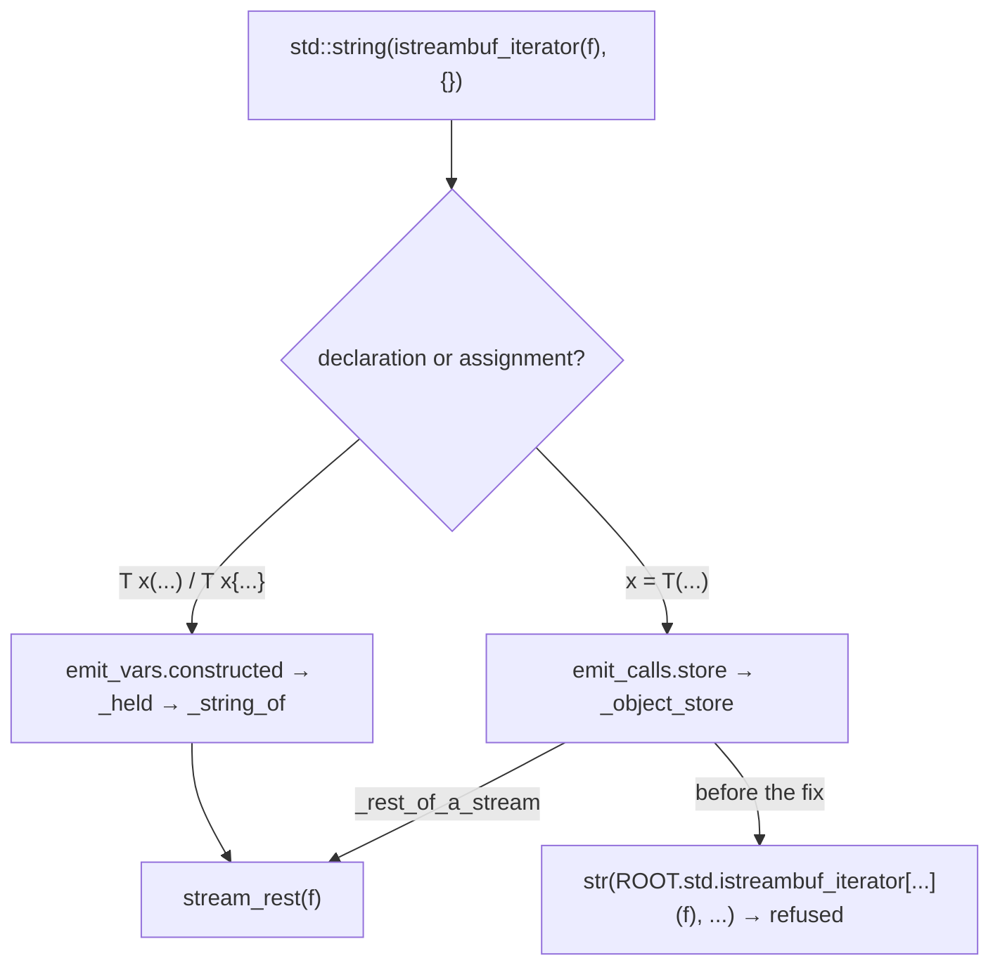

The same C++ construction takes two different paths through this translator depending on whether it is written as a declaration or as an assignment, and an exact-name match on a template's spelling silently misses the form a real program writes.

## The same construction, two paths

ROOT's `roottest/root/io/datamodelevolution/common/Dumper.h` reads a whole file into a `std::string`:

```cpp
std::string str1;
str1 = std::string(std::istreambuf_iterator<char>(f1), std::istreambuf_iterator<char>());
```

`emit_vars._string_of` has answered that as `stream_rest(f1)` since round 108 — but only for the **declaration** form, `std::string s(std::istreambuf_iterator<char>(f), ...)`, because `_held`/`constructed` are the declaration path. An **assignment** goes through `emit_calls.store` → `_object_store`, which never asked the question, so it fell through to `self.value(node)` and emitted a Python `str(a, b)` that resolved `ROOT.std.istreambuf_iterator` at run time and refused.

The fix is a second ask on the assignment side (`emit_calls._rest_of_a_stream`) with the same predicate. **When a construction is recognised in `emit_vars`, check whether `emit_calls.store` reaches it too** — the two are separate code paths to the same C++ meaning, and only one of them is usually tested.



## An exact name match misses the template

`_streambuf` read the call's own spelling:

```python
return node.args[0] if node.func.last == "istreambuf_iterator" else None
```

`node.func.last` for `std::istreambuf_iterator<char>(f)` is `istreambuf_iterator<char>` — the arguments are part of the name. Compare against the **stem**:

```python
return node.args[0] if node.func.last.split("<")[0] == "istreambuf_iterator" else None
```

The same trap bit `parse_types` twice (a template parameter's name, an integral constant's name), so grep for `== "..."` on a parsed name that may carry `targs`.

## How to check it

```bash
export PYTHONPATH=$PWD/src
.venv/bin/python -c "
from xrdroot.pycint import translate
print(translate('void f(const char*n){std::ifstream in(n); std::string s; s = std::string(std::istreambuf_iterator<char>(in), std::istreambuf_iterator<char>());}','t.C'))"
# -> s = stream_rest(in_)
.venv/bin/python -m pytest -q tests/test_cint_expressions.py -k rest_of_a_stream
```

## A cancelled CI run's red X is not a failure

`gh run list` shows `X` on steps of a run another push pre-empted. Read the check-run annotations first:

```bash
gh api repos/<owner>/<repo>/check-runs/<job-id>/annotations | jq -r '.[].message'
# -> "The operation was canceled."   concurrency, not a test result
```

A round whose own run was cancelled is **not certified**: re-run it in a quiet window, or say plainly that it was cancelled and that the local gate is the only evidence.
