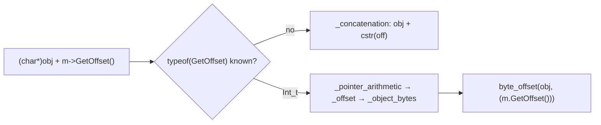

When a translated expression comes out wrapped in `cstr(...)`, the cause is almost always a **missing dialect declaration**, not a parser bug: the emitter treats `+` as a string concatenation when the left side is a `char *` and the right side's type is unknown.

## The case that found it

`roottest/root/io/datamodelevolution/common/Generator.h` fills a class member by member:

```cpp
*(int *)(((char *)obj) + member->GetOffset()) = genInt();
```

`TDataMember::GetOffset` had no entry in `pycint/dialect.py::RETURNED`, so `typeof(m->GetOffset())` was `None`, `_pointer_arithmetic` said no, and `_concatenation` won. The translated line was:

```text
(obj + cstr(m.GetOffset()))[0] = 7      # a string concatenation, then item assignment on the object
```

Three declarations fix it — `("TDataMember", "GetOffset"): "Int_t"`, `"GetDataType": "TDataType*"`, `"GetTrueTypeName": "const char*"` — and the line becomes `byte_offset(obj, (m.GetOffset()))[0] = 7`.



## How to check your own

```bash
export PYTHONPATH=$PWD/src
.venv/bin/python -c "import sys; sys.path.insert(0,'src')
from xrdroot.pycint import translate
print(translate('void f(void* o, TDataMember* m){ *(int*)(((char*)o)+m->GetOffset())=7; }','t.C'))"
```

A `cstr(` where you expect an address is the tell. The declaration belongs in `RETURNED`, beside `("TClass", "GetBaseClassOffset")`, which was added for exactly the same reason.

## The wall just behind it

`byte_offset` then has to know the class's member offsets, and this kit keeps **two** tables — one in `pyroot/core/reflection.py` (`TDataMember::GetOffset`) and one in `cppstd/cells.py` (`byte_offset`). For `ClassA` in that test they disagree: reflection answers 8 and `cppstd` answers nothing, so `byte_offset` returns the object and `p[0] = v` raises `'ClassA' object does not support item assignment`. The right shape is **one list** — `_cxx_offsets_`, written on the class by the translation from `pycxx/sizes.member_offsets` (the Itanium walk with the bases in it: `struct C : B { int c; double d; }` gives `[4, 8]`) — and both readers taking it from there. That shape was written and **reverted**: it moved an existing expectation (`Plain::var` from offset 0 to 88), and 88 was not checked against `Plain`'s declaration first. Check the number against the class before correcting the test.
