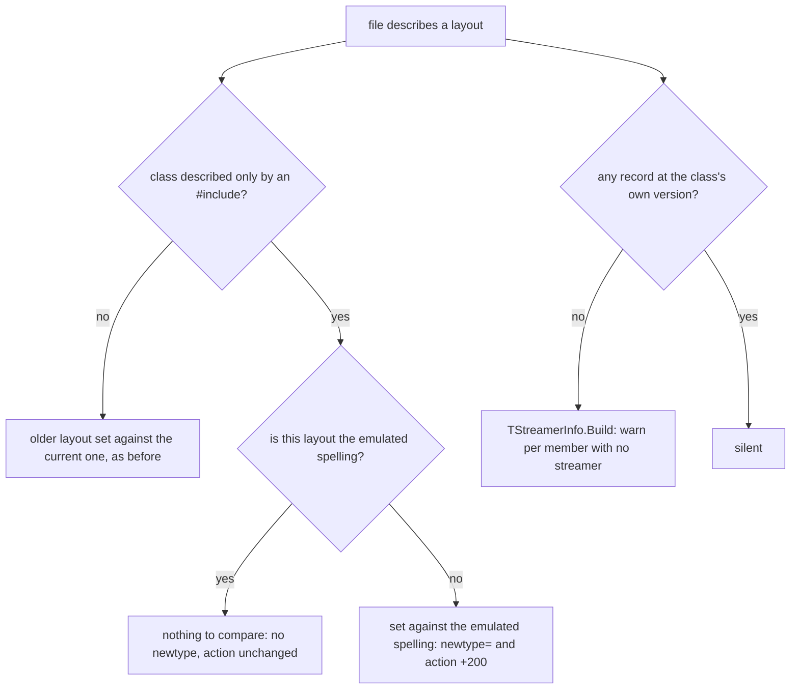

A class the session only *declares* (an `#include`, no dictionary) has a layout in memory from the first file read, so **every** file layout is set against it — the current one included — and the emulated copies are not. `TStreamerInfo::Build`'s "has no streamer or dictionary" warning is a different event: ROOT builds the class's own layout only where **no file recorded one at the version the class gives it**, which the read order decides.

## The two rules

Set against the class's own layout, a file's mapped spelling of `io/stdpair`'s pair prints

```
reco::Muon::MuonTrackType first           offset=  0 type= 3 newtype=13
 i= 0, first           type=203, offset=  0, len=1, method=0
```

— `type= 3` is the file's `kInt`, `newtype=13` the `kUInt` the member is today, and the action reads
200 (`TVirtualStreamerInfo::kConv`) above the type because `TStreamerInfo::Compile` adds `kConv` when
`fNewType != fType` (`io/io/src/TStreamerInfoActions.cxx`). An **emulated** copy is already that
spelling, so it carries neither. The `Emulation` element title is the tell
(`R__CreateEmulatedElement`).

`TStreamerInfo::Build` warns per *member* whose class it has no streamer for:

```
Warning in <TStreamerInfo::Build>: pair<...>: edm::Ref<...> has no streamer or dictionary, data member "second" will not be saved
```

and it is printed where ROOT *builds* the class's own layout — not where it reads a file's.

## What decides the build, measured

`TClass::GetStreamerInfo` makes a layout with `NewInfo` + `Build` when nothing sits at the class's
own version (`core/meta/src/TClass.cxx`). On the 6.40 oracle with `#include "cmspair.h"` first:

| read order | slot 1 | `fOnFileClassVersion` | warning |
|---|---|---|---|
| `ab02.root` then `aa02.root` | `0xb15d1241` | 1 — a file's copy | none |
| `aa02.root` then `ab02.root` | `0xb15d1241` | 0 — **built** | yes |

Same checksum either way; only the provenance differs. The slot is not the version a layout
recorded (`_free_version` renumbers), so ask the **records**: "did any file record this checksum at
the class's own version?" (`_recorded_at`). A member spelled with a number's streamer code
(`< 61`, `kObject`) is no class and is passed over — the pair's enumeration is `3`, its `edm::Ref`
member `62`.


